<p align="center">
  <picture>
    <source media="(prefers-color-scheme: dark)" srcset="docs/images/sammlarr-logo-dark.svg">
    
  </picture>
</p>
<p align="center">
  Follow movie and show lists from MDBList, TMDB, Trakt, AniList and MyAnimeList, filter them,
  and send what is left to your Plex watchlist or to Radarr and Sonarr.
</p>
<p align="center">
  <a href="#what-it-does">What it does</a> ·
  <a href="#quick-start">Quick start</a> ·
  <a href="#configuration">Configuration</a> ·
  <a href="#providers">Providers</a> ·
  <a href="#which-links-work-and-why">Which links work</a> ·
  <a href="#updating">Updating</a>
</p>

<p align="center">
  <picture>
    <source media="(prefers-color-scheme: dark)" srcset="docs/images/readme/feed-editor-dark.png">
    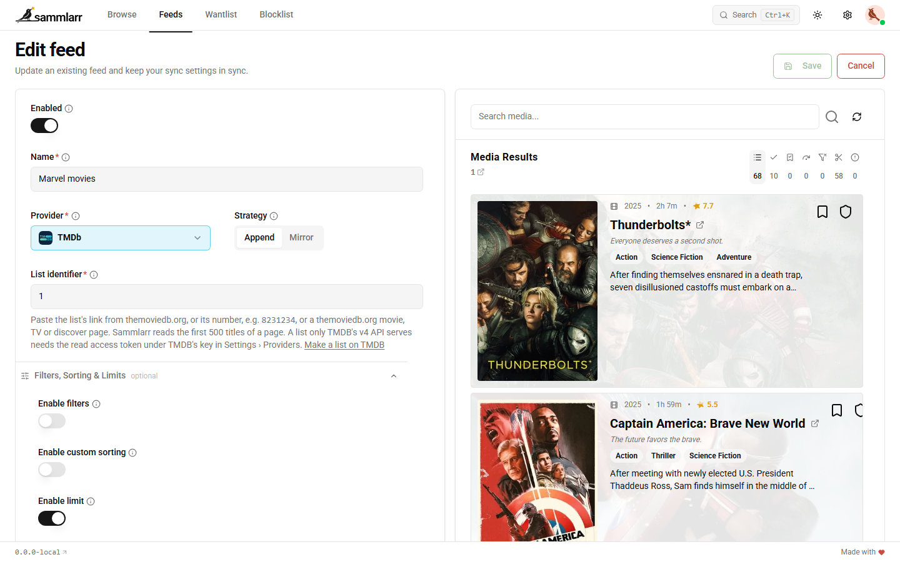
  </picture>
</p>

## What it does

Sammlarr is a self-hosted web app. You point a feed at a list or a chart on another site, tell it what to keep, and it
puts the titles on your wantlist, which it syncs to your Plex watchlist or to Radarr and Sonarr.

- **Feeds** follow a list, a chart or a search page on MDBList, TMDB, Trakt, AniList or MyAnimeList. IMDb and
  Letterboxd lists work through MDBList.
- **Filters, sort and limit** per feed: title, genre, movie or show, release date, rating, votes, runtime, seasons and
  episodes. The editor shows a live preview of what the feed would add.
- **Schedules**: run a feed by hand or on a schedule. Append only adds titles; Mirror also removes the ones that left
  the list.
- **Matching**: every title is matched to its IMDb, TMDB and TVDB ids before it goes anywhere. A title whose ids do not
  lead to exactly one title is left out, never guessed.
- **Ratings** from IMDb, TMDB, Rotten Tomatoes, Metacritic, Letterboxd, Trakt, MyAnimeList and AniList, combined into
  one Sammlarr rating you can filter and sort by.
- **Several people** share one install, each with their own feeds, wantlist, blocklist and API keys. They sign in with
  Plex or with Sammlarr accounts.

How it works:

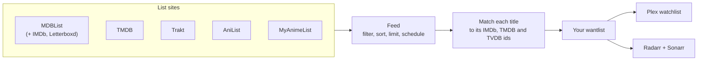

<p align="center">
  
</p>
<p align="center"><sub>A feed run as it happens. The Feeds page shows this while one of your feeds runs.</sub></p>

## Screenshots

<table>
  <tr>
    <td width="50%">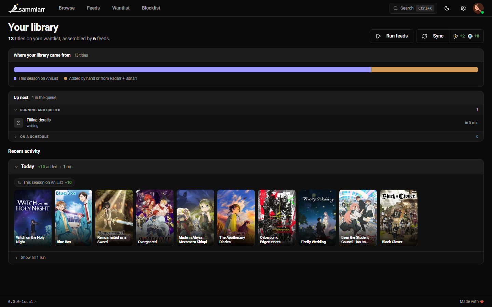<br><sub>Home: your library's numbers, what runs next, activity by day.</sub></td>
    <td width="50%">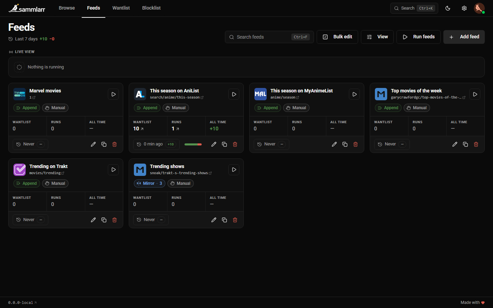<br><sub>Feeds: every feed and how its last run went.</sub></td>
  </tr>
  <tr>
    <td width="50%">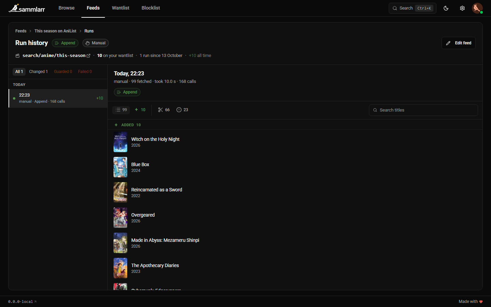<br><sub>A feed's runs: each run as a dot, what it added and how many titles it could not match.</sub></td>
    <td width="50%"><br><sub>Wantlist: your titles and whether they reached Plex or Radarr and Sonarr.</sub></td>
  </tr>
  <tr>
    <td width="50%">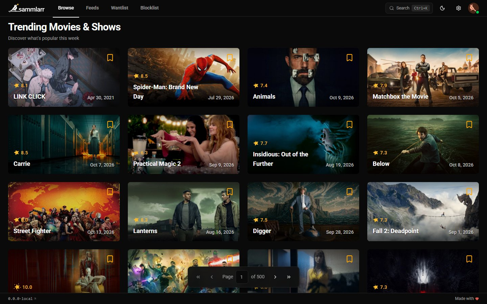<br><sub>Browse: what is trending, to add by hand.</sub></td>
    <td width="50%">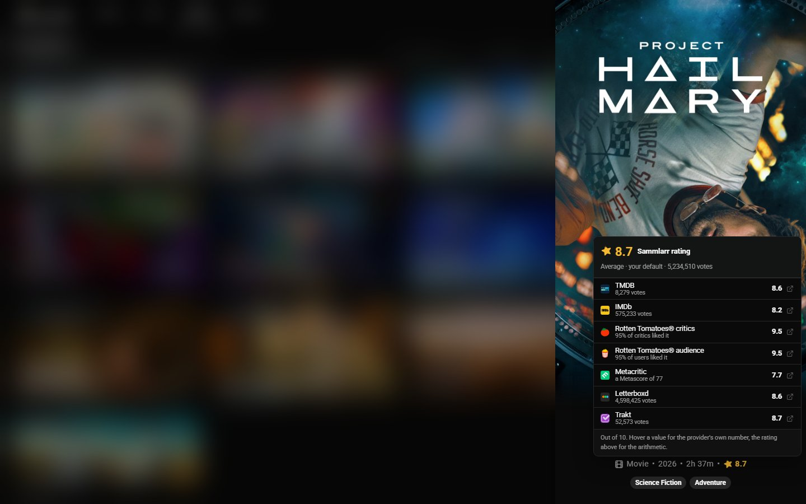<br><sub>A title's ratings from every source.</sub></td>
  </tr>
  <tr>
    <td width="50%">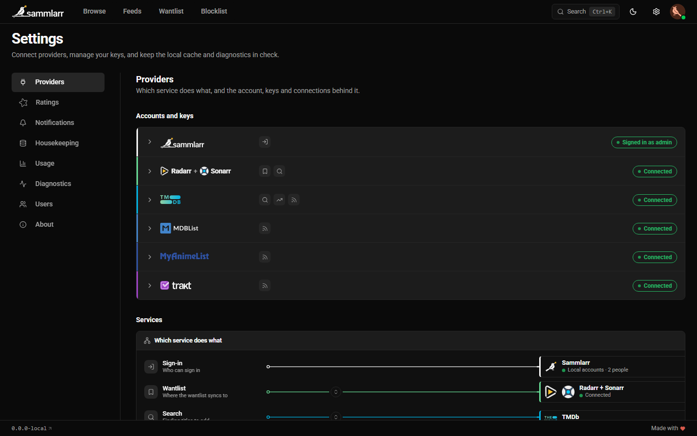<br><sub>Settings › Providers: which service does what, and your keys.</sub></td>
    <td width="50%">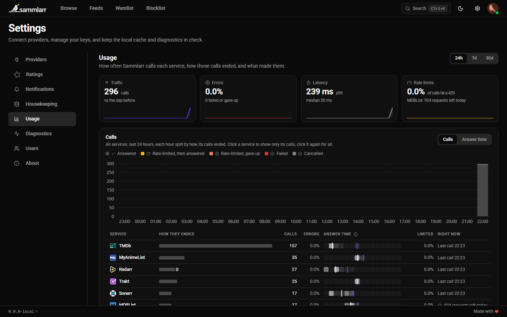<br><sub>Settings › Usage: calls per service and what made them.</sub></td>
  </tr>
  <tr>
    <td width="50%">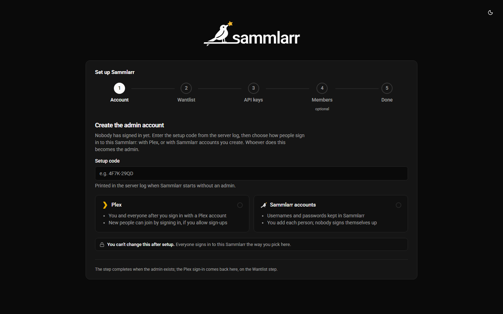<br><sub>The first-run wizard.</sub></td>
    <td width="50%"></td>
  </tr>
</table>

## Quick start

Sammlarr ships as one container image, `ghcr.io/daerup/sammlarr`, tagged with each release's version (`:0.1.0`) and
`:latest`. It is built for `linux/amd64`. You need Docker with Compose.

1. Make a folder for Sammlarr and a `data` folder inside it. The container runs as user `1654`, so that user has to
   own `data`:

   ```sh
   mkdir -p sammlarr/data && cd sammlarr
   sudo chown 1654:1654 data
   ```

   If you would rather keep the folder's owner, run the container as that owner instead with a `user:` line in the
   compose file below, for example `user: "99:100"` on Unraid.

2. Save this as `compose.yaml`, with your own time zone:

   ```yaml
   services:
     sammlarr:
       image: ghcr.io/daerup/sammlarr:latest
       ports:
         - "6769:6769"
       volumes:
         - ./data:/data
       environment:
         - TZ=Europe/Zurich
       restart: unless-stopped
   ```

3. Start it and read the setup code from the log:

   ```sh
   docker compose up -d
   docker compose logs sammlarr
   ```

   The first start logs a line like `No admin yet. Open /setup and enter setup code 7KQ4-M2XP`.

4. Open `http://<your server>:6769/setup` and walk through the wizard:
   - **Account**: enter the setup code and pick how people sign in, with Plex or with Sammlarr accounts. Whoever does
     this becomes the admin. This choice is fixed for the install.
   - **Wantlist**: where titles go. Your Plex watchlist, where a tool like Overseerr or Pulsarr can pick them up, or
     Radarr and Sonarr directly. You can switch later in Settings › Providers.
   - **API keys**: a TMDB key is needed on every install. Each person adds their own keys; see [Providers](#providers).
   - **Sign-ups** (Plex) or **Members** (Sammlarr accounts): open Plex sign-ups, or add the people who get an account.
   - **Done**: what is set up, and a link to Settings for a key you left out.

Then create your first feed: paste a list's link, check the preview, save.

## Configuration

Everything you choose in the app lives in the database under `/data`. The container takes two settings:

| Variable | Default | What it does |
|---|---|---|
| `TZ` | UTC | The time zone feed schedules and the nightly jobs run in, for example `Europe/Zurich`. |
| `Sammlarr__Accounts__MinimumPasswordLength` | `12` | The shortest password a Sammlarr account may have. |

If port 6769 is taken, change the host side of the mapping (`"8080:6769"`).

### Backups

`/data` holds the database and `dp-keys`, the key ring that encrypts the stored API keys and sign-ins. Back up the
whole folder with the container stopped, and keep the two together.

## Providers

Sammlarr ships no API keys. Each service ties a key to its owner and counts calls against it, so each person adds
their own in Settings › Providers, where the keys are stored encrypted. The admin sets up Radarr and Sonarr once for
the install. Settings › Usage (admin only) shows how many calls each service got and why.

| Service | Sammlarr uses it for | Needs | Where to get it | Free limits |
|---|---|---|---|---|
| TMDB | search, trending titles in Browse, posters and details, the ids Radarr and Sonarr need, TMDB feeds, the TMDB rating | an API key, on every install; the read access token too for lists only TMDB's v4 API serves | [themoviedb.org › Settings › API](https://www.themoviedb.org/settings/api) | free for non-commercial use; about 40 requests a second |
| Plex | sign-in, if you chose it; each person's watchlist, if that is where titles go; search, ids, details and ratings | a Plex account, connected in Settings › Providers | [plex.tv](https://www.plex.tv) | none published |
| Radarr + Sonarr | the other place titles go: movies to Radarr, shows to Sonarr, tagged per person | each one's address and API key (Settings › General there), a root folder and a quality profile | your own instances | none |
| MDBList | MDBList feeds, and IMDb and Letterboxd lists added there; ratings from eight sources; ids | an API key | [mdblist.com › Preferences › API](https://mdblist.com/preferences/#api), with a free account | 1,000 requests a day on a free account; supporters get more |
| Trakt | Trakt feeds, the Trakt rating, ids | your own client ID | [developer.trakt.tv › My Apps](https://developer.trakt.tv/apps); Trakt asks for a verified GitHub account and deletes an app unused for 30 days | 1,000 calls every 5 minutes |
| AniList | AniList feeds, anime details and the AniList rating | nothing | | 90 requests a minute, 30 while AniList runs degraded |
| MyAnimeList | MyAnimeList feeds, anime details and the MyAnimeList rating | a client ID | [myanimelist.net › API](https://myanimelist.net/apiconfig); the key's form in Settings › Providers says what to enter | none published |
| Wikidata, TVmaze | ids for titles other services do not know; show details | nothing | | TVmaze: 20 calls every 10 seconds |
| IMDb datasets, anime-lists | IMDb ratings and an anime id map, downloaded once a day | nothing | | |

Notifications (a webhook or Pushover, per person) are set up in Settings › Notifications.

## Which links work, and why

Paste a link into a feed and the editor either takes it or says why not; a private list shows when the preview loads.
This section was checked against Sammlarr on 2026-10-13.

| Your list is on | Paste it into | Needs | Limits |
|---|---|---|---|
| MDBList | an MDBList feed | an MDBList API key | none beyond MDBList's daily requests |
| IMDb (list, watchlist, chart) | an MDBList feed, after adding it on mdblist.com as an external list | an MDBList API key | a free MDBList account adds one external list, refreshed weekly |
| Letterboxd (list) | an MDBList feed, the same way | an MDBList API key | the same |
| TMDB (list, movie or TV page, discover, keyword, company or network page) | a TMDB feed | a TMDB API key; the read access token for a list only TMDB's v4 API serves | pages: the first 500 titles |
| Trakt (watchlist, public list, trending, popular or anticipated chart) | a Trakt feed | your own Trakt client ID | the profile must be public; charts: the first 500 titles |
| AniList (anime list, search page) | an AniList feed | nothing | the list must be public; searches: the first 500 titles |
| MyAnimeList (anime list, top anime, season) | a MyAnimeList feed | a MyAnimeList client ID | the list must be public; pages: the first 500 titles |
| TheTVDB | not followed | | |
| Plex watchlist | not a feed: it is where your wantlist goes, and a sync pulls your own watchlist in | | |

### Charts and other pages

A feed can follow more than a list. It can follow a site's chart, ranking or search page, which changes on its own
between runs.

| Kind | Examples | Changes | What a run reads |
|---|---|---|---|
| A list | an MDBList list, a TMDB list, a Trakt list or watchlist, an AniList or MyAnimeList anime list | when its owner edits it | every title, in the list's order |
| A chart | Trakt trending, popular, anticipated; TMDB popular, top rated, now playing, upcoming; MyAnimeList top anime; AniList trending and top 100 | every day, by the site's own ranking | the first 500 titles, in the chart's order |
| A season or calendar page | MyAnimeList this season or a given season; AniList this season, next season or a season search; TMDB airing today, on the air | as the season moves on | the first 500 titles |
| A search or discover page | AniList's search with its filters; TMDB discover, keyword, company and network pages | as new titles match | the first 500 titles, sorted as the page sorts them |

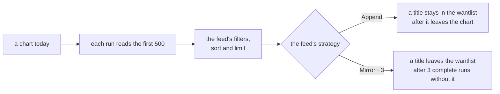

- **The limit counts after the filters.** "The top 20 of Trakt's trending shows rated 7 or better" reads the chart,
  drops what fails the filters, then keeps 20.
- **Append or Mirror decides what a chart does to the wantlist.** Append only adds, so a chart builds up a backlog of
  everything that was ever on it. Mirror also removes what this feed added once the title has been missing from 3
  complete runs in a row (you set the number per feed). Missing means it left the chart, or it no longer passes the
  feed's filters or limit. So the wantlist follows the chart.
- **Only a complete run counts.** A run is complete when it read the whole source, looked up every title and let at
  least one through the filters. Any other run removes nothing and counts nothing as missing, so a site that is down
  or a lookup that hit a rate limit never empties your wantlist.
- **The schedule sets how closely a feed follows.** A daily chart on a weekly schedule only sees one day a week.
- **Why 500**: charts, searches and discover pages never end, and a run must. Lists are read whole.
- Pick by what you want: "what everyone watches right now" is a chart with Mirror, "everything that was ever big" a
  chart with Append, "this season's anime" a season page with Mirror.

### What each site's feed takes

<details>
<summary><b>MDBList</b></summary>

Works:

- a list's link, `https://mdblist.com/lists/{owner}/{list}`, or just `{owner}/{list}`
- the list's number. Sammlarr looks it up with your key, since mdblist.com has no page by number.
- an external list, `https://mdblist.com/lists/{you}/external/{id}`

Not followed: anything else, an IMDb, Trakt or Letterboxd link pasted directly included. The editor says "Paste the
list's link from mdblist.com, its owner/list, or its number."

</details>

<details>
<summary><b>TMDB</b></summary>

Works:

- a list: `https://www.themoviedb.org/list/{id}`, or the number alone
- the movie and TV pages: `/movie` (popular), `/movie/now-playing`, `/movie/upcoming`, `/movie/top-rated`, `/tv`
  (popular), `/tv/airing-today`, `/tv/on-the-air`, `/tv/top-rated`, with their region, language or timezone
- a discover link, `/discover/movie` or `/discover/tv` with its filters, and `/movie` or `/tv` with filters, which is
  the same thing
- `/keyword/{id}/movie` or `/tv`, `/company/{id}/movie` or `/tv`, `/network/{id}/tv`

Not followed:

- a discover preset such as "new on streaming": "Sammlarr cannot follow TMDB's new-on-streaming preset, since the API
  has no list for it. Paste the discover link its filters give."
- `/tv/upcoming`, collections, people and a single movie or show page, which have no list in TMDB's API
- a streaming-service filter without its `watch_region`, and a certification without its `certification_country`,
  because TMDB counts both per country
- a filter on a page that has none in the API, for example a genre on `/movie/now-playing`: "Sammlarr cannot follow
  TMDB's with_genres filter. Remove it from the page, or filter in Sammlarr."

A list only TMDB's v4 API serves needs the read access token, from the same TMDB settings page as the key.

</details>

<details>
<summary><b>Trakt</b></summary>

Works:

- a username alone, which follows that person's watchlist
- `https://trakt.tv/users/{user}` or `/users/{user}/watchlist`
- `https://trakt.tv/users/{user}/lists/{list}` and `https://trakt.tv/lists/{id}`
- the charts `/movies/trending`, `/movies/popular`, `/movies/anticipated` and the same under `/shows/`
- `https://app.trakt.tv/discover/{trending, popular or anticipated}`, with `?mode=movie` or `?mode=show`, or both
  charts without a mode

Links on `app.trakt.tv` work the same as on `trakt.tv`.

Not followed: other charts and pages (box office, most watched, people), and a private profile: "Trakt keeps the
profile behind users/{user}/watchlist private, so Sammlarr cannot read it."

</details>

<details>
<summary><b>AniList</b></summary>

Works:

- a username, which follows the whole anime list
- `{user}/{status}`, with `current`, `planning`, `completed`, `dropped`, `paused` or `repeating`
- `https://anilist.co/user/{user}/animelist`, with or without one of those statuses at the end
- `https://anilist.co/search/anime` with its filters: search, genres and tags, year, season, format, airing status,
  source material, country of origin, year range and sort
- the presets under it: `trending`, `popular`, `top-100`, `new`, `favorites`, `top-tv`, `top-tv-shorts`,
  `top-movies`, `top-ova`, `top-ona`, `this-season`, `next-season`

AniList's Watching and Rewatching lists are `current` and `repeating` here.

Not followed: the streaming, episodes and duration filters, manga, studio and staff pages, and a private list:
"AniList keeps the list of {user} private, so Sammlarr cannot read it."

</details>

<details>
<summary><b>MyAnimeList</b></summary>

Works:

- a username, `https://myanimelist.net/animelist/{user}` or `/profile/{user}`. A status in the link is ignored; the
  feed reads the whole list.
- `https://myanimelist.net/topanime.php` with `type` set to `all`, `airing`, `upcoming`, `tv`, `ova`, `movie`,
  `special`, `bypopularity` or `favorite`, and its `limit` to start further down
- `/anime/season` (this season) and `/anime/season/{year}/{season}`

Not followed: the search, "Sammlarr cannot follow MyAnimeList's search, since it ranks by relevance. Paste a top anime
or season link."; the ONA and music rankings, genre and studio pages, and a private list: "MyAnimeList keeps the list
of {user} private, so Sammlarr cannot read it."

</details>

### Why some lists only work through MDBList

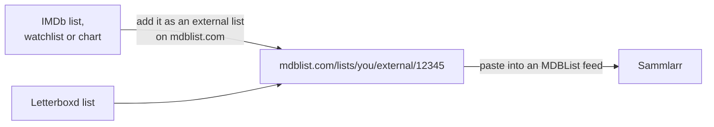

- **IMDb** has no API for lists. Its pages answer scripts with a bot check, its conditions of use forbid scraping, and
  its own data API is a paid AWS product. MDBList mirrors IMDb lists, watchlists and charts as external lists.
- **Letterboxd** gives API access by application only, and not to private or personal projects. MDBList mirrors its
  lists and watchlists too.
- **A free MDBList account** adds one external list, refreshed weekly, and stops updating its lists after 120 days
  without activity on mdblist.com (a note on the list warns at 90). Supporters get more external lists, refreshed
  daily, and no inactivity rule.
- **Trakt lists added on MDBList no longer update.** Trakt blocked MDBList from its API in September 2026. Follow a
  Trakt list with a Trakt feed instead.
- **TheTVDB** licenses its API per project, priced by the project's revenue, and its terms keep a key confidential to
  the project it was issued for. Sammlarr ships no key and never calls TheTVDB: TVDB ids come from other services, and
  TheTVDB's pages are only linked. So it follows no TVDB lists.
- **Private lists** on Trakt, AniList and MyAnimeList would need each person to sign in to that site. Sammlarr reads
  only what the site shows to anyone, so make the list public.
- **Only pages that map onto the site's API** are followed, because only those come back with the same titles in the
  same order. MyAnimeList's search ranks by relevance, which its API cannot repeat; TMDB's presets, collections and
  people have no list in its API. The editor says so when you paste one.
- **Your own keys**: Sammlarr ships none, so each person uses their own (see [Providers](#providers)). Trakt's API
  policy allows a personal or self-hosted tool on your own credentials.

## Updating

`:latest` moves to every new release. To update:

```sh
docker compose pull
docker compose up -d
```

To choose when you upgrade, pin a version instead, `ghcr.io/daerup/sammlarr:0.1.0`, and change it when you are ready.
Auto-updaters like Watchtower follow `:latest` too. Settings › About shows a badge, and the version in the footer a dot,
once a newer release is out.

Read the release notes first. Breaking changes are listed at the top, under BREAKING CHANGES. Sammlarr updates its
database when it starts, so going back to an older version needs a copy of `/data` from before the update (see
[backups](#backups)).
