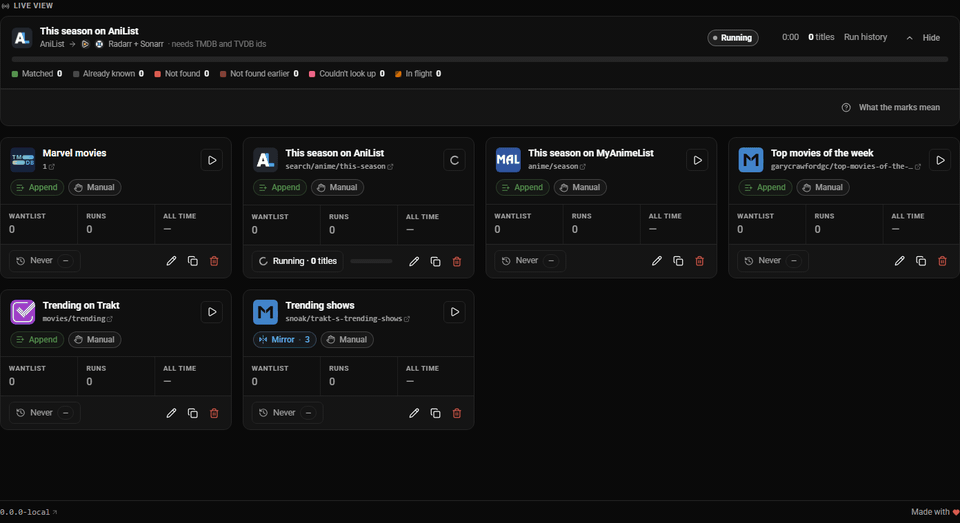
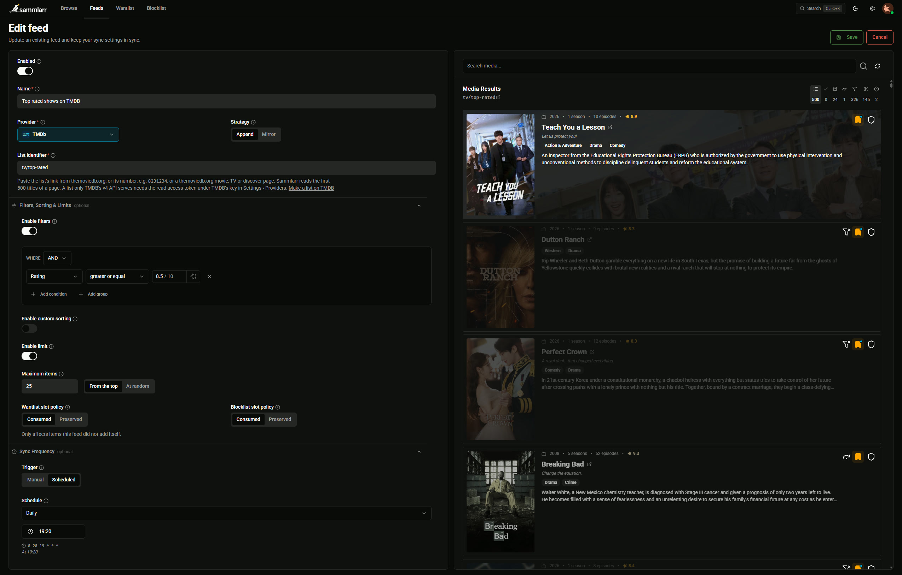
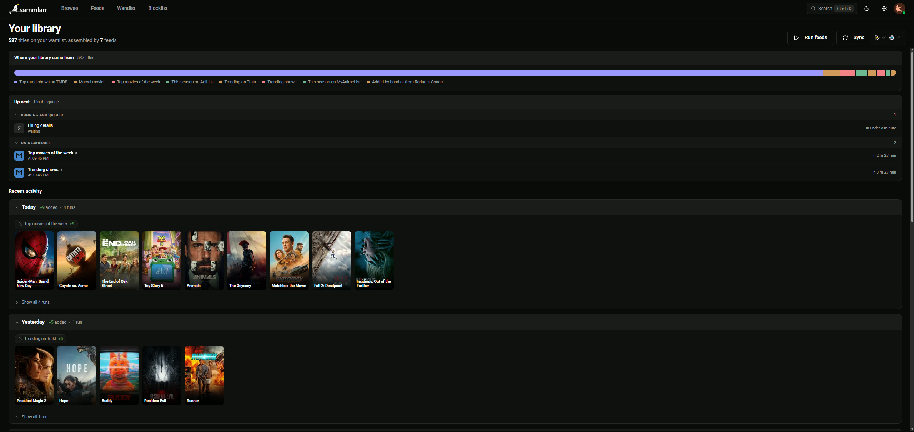
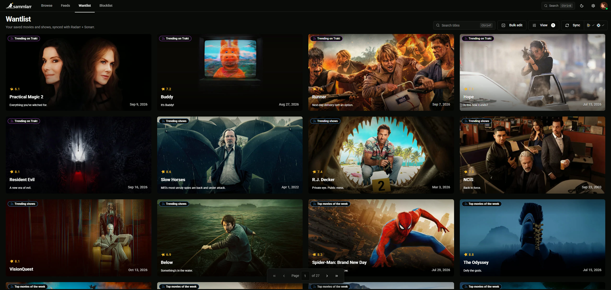

<p align="center">
  <picture>
    <source media="(prefers-color-scheme: dark)" srcset="docs/images/sammlarr-logo-dark.svg">
    
  </picture>
</p>
<p align="center">
  <a href="https://github.com/daerup/Sammlarr/actions/workflows/ci.yml"></a>
  <a href="https://github.com/daerup/Sammlarr/actions/workflows/codeql.yml"></a>
  <a href="https://github.com/daerup/Sammlarr/actions/workflows/ci.yml"></a>
  <a href="https://scorecard.dev/viewer/?uri=github.com/daerup/Sammlarr"></a>
  <a href="https://github.com/daerup/Sammlarr/releases/latest"></a>
</p>
<p align="center">
  Follow movie and show lists from MDBList, TMDB, Trakt, AniList and MyAnimeList, filter them,
  and send what is left to your Plex watchlist or to Radarr and Sonarr.
</p>
<p align="center">
  <a href="#what-it-does">What it does</a> ·
  <a href="#quick-start">Quick start</a> ·
  <a href="#providers">Providers</a> ·
  <a href="#updating">Updating</a> ·
  <a href="docs/faq.md">FAQ</a>
</p>

## What it does

Sammlarr is a self-hosted web app. You point a feed at a list or a chart on another site, tell it what to keep, and it puts the titles on your wantlist, which
it syncs to your Plex watchlist or to Radarr and Sonarr.

- **Feeds** follow a list, a chart or a search page on MDBList, TMDB, Trakt, AniList or MyAnimeList. IMDb and Letterboxd lists
  work [through MDBList](docs/faq.md#why-do-imdb-and-letterboxd-lists-only-work-through-mdblist).
- **Filters, sort and limit** per feed, on genre, release date, rating, runtime and more. The editor previews what the feed would add.
- **Schedules**: run a feed by hand or on a schedule. Append only adds titles; Mirror also removes the ones that left the list.
- **Matching**: every title is matched to its IMDb, TMDB and TVDB ids. A title that does not lead to exactly one match is left out, never guessed.
- **Ratings** from IMDb, TMDB, Rotten Tomatoes, Metacritic, Letterboxd, Trakt, MyAnimeList and AniList, combined into one Sammlarr rating you can filter and
  sort by.

<p align="center">
  
</p>
<p align="center"><sub>A feed run as it happens. The Feeds page shows this while one of your feeds runs.</sub></p>

## Screenshots

<p align="center">
  
</p>
<p align="center"><sub>The feed editor: the source, filters, a limit and a schedule, with a preview of what the feed would add.</sub></p>

<p align="center">
  
</p>
<p align="center"><sub>Home: where your library came from, what runs next and what each day added.</sub></p>

<p align="center">
  
</p>
<p align="center"><sub>Wantlist: every title and the feed that added it, synced to Radarr and Sonarr.</sub></p>

## Quick start

Sammlarr runs as one container, `ghcr.io/daerup/sammlarr`, tagged `:latest` and with each release's version (`:0.1.0`). Releases after 0.1.0 run on
`linux/amd64` and `linux/arm64`, 0.1.0 on `linux/amd64` only. You need
Docker with Compose.

1. Download the example [`compose.yaml`](compose.yaml) into a folder for Sammlarr and set its `TZ` to your time zone, the one schedules and times in the app
   use:

   ```sh
   mkdir sammlarr && cd sammlarr
   curl -LO https://raw.githubusercontent.com/daerup/Sammlarr/main/compose.yaml
   ```

   It runs the latest image on port 6769 and keeps the data in the `sammlarr-data` volume.

2. Start it and read the setup code from the log:

   ```sh
   docker compose up -d
   docker compose logs sammlarr
   ```

   The first start logs a line like `No admin yet. Open /setup and enter setup code 7KQ4-M2XP`.

3. Open `http://<your server>:6769/setup`, enter the setup code and follow the wizard.

Then create your first feed: paste a list's link, check the preview, save.

## Providers

Sammlarr ships no API keys. Each person adds their own in Settings › Providers, where they are stored encrypted. Only TMDB is needed on every install; the
others add their feeds and ratings. The admin sets up Radarr and Sonarr once for the install.

| Service         | Used for                                                       | Needs                                                                   |
|-----------------|----------------------------------------------------------------|-------------------------------------------------------------------------|
| TMDB            | search, Browse, posters and details, TMDB feeds                | an [API key](https://www.themoviedb.org/settings/api)                   |
| Plex            | sign-in and the watchlist, if you chose them; ids and ratings  | a Plex account                                                          |
| Radarr + Sonarr | sending movies to Radarr and shows to Sonarr                   | each one's address and API key                                          |
| MDBList         | MDBList, IMDb and Letterboxd feeds; ratings from eight sources | an [API key](https://mdblist.com/preferences/#api), with a free account |
| Trakt           | Trakt feeds and the Trakt rating                               | a [client ID](https://developer.trakt.tv/apps)                          |
| AniList         | AniList feeds and the AniList rating                           | nothing                                                                 |
| MyAnimeList     | MyAnimeList feeds and the MyAnimeList rating                   | a [client ID](https://myanimelist.net/apiconfig)                        |

Wikidata, TVmaze, the IMDb datasets and anime-lists fill in ids, details and IMDb ratings, with no key. What each service allows for free is in
the [FAQ](docs/faq.md#what-do-the-services-allow-for-free).

Notifications (a webhook or Pushover, per person) are set up in Settings › Notifications.

## Updating

`:latest` moves to every new release. To update:

```sh
docker compose pull
docker compose up -d
```

To choose when you upgrade, pin a version in the `image:` line instead, `ghcr.io/daerup/sammlarr:0.1.0`, and change it when you are ready. Auto-updaters like
Watchtower follow `:latest` too. Settings › About shows a badge, and the version in the footer a dot, once a newer release is out.

Read the release notes first. Breaking changes are listed at the top, under BREAKING CHANGES. Sammlarr updates its database when it starts, so going back to an
older version needs a copy of the data from before the update (see [backups](#backups)).

## Backups

The `sammlarr-data` volume holds the database and `dp-keys`, the key ring that encrypts the stored API keys and sign-ins. Keep the two together: stop the
container and copy the whole volume, here into `sammlarr-data.tgz` next to the compose file:

```sh
docker compose stop
docker run --rm -v sammlarr-data:/data:ro -v "$PWD":/backup busybox tar czf /backup/sammlarr-data.tgz -C /data .
docker compose start
```
