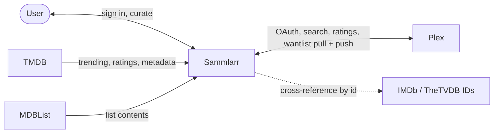

# 2. Context and Scope

Sammlarr sits between one user and a handful of external media services. It stores curation,
not a catalogue: the feeds a user has defined, what is on their wantlist, what they have
blocklisted. Titles, ratings and metadata come from the services. One wantlist stays in
sync with Plex.

## Business Context

| Partner | Sammlarr receives | Sammlarr sends |
|---|---|---|
| User | Sign-in; feed, wantlist and blocklist edits | The curated library, wantlist and notifications |
| Plex | OAuth identity, search results, ratings (IMDb, Rotten Tomatoes, a copy of TMDB's), the Plex watchlist | Wantlist additions and removals (push) |
| TMDB | Trending titles, ratings, metadata, id conversion | (none, read only) |
| MDBList | The contents of a list, for feeds | (none, read only) |
| IMDb, Rotten Tomatoes, TheTVDB | (none) | (none; identifier namespaces only, see below) |

Plex is the only two-way integration. Sammlarr reads the wantlist from Plex and writes
changes back to it. TMDB and MDBList are read-only. IMDb and TheTVDB are never called at all;
they exist only as identifier namespaces (`ImdbId`, `TvdbId`) used to match the same title
across providers.

## Technical Context

| System | Integration | Direction |
|---|---|---|
| Plex | Plex OAuth (PIN flow) for sign-in; HTTPS/JSON for search, ids (its match and metadata endpoints) and the wantlist; additions and removals via HTTP `PUT` to the Plex watchlist endpoints | Read + Write |
| TMDB | REST API, authenticated with an API key | Read only |
| MDBList | REST API with an API key; list entries are paged and resolved to media | Read only |
| IMDb, Rotten Tomatoes, TheTVDB | No HTTP client of their own; `ImdbId` / `TvdbId` value objects reached through Plex or TMDB lookups, `RottenTomatoesId` (a page path) through Wikidata | Reference only |

Provider credentials and API keys are held as `[Sensitive]` secrets and redacted from logs.
Every outbound provider call passes a lane: one per remote service, route and owner, pacing its requests by the
limits the provider publishes, holding back on a 429 and closing for a while after repeated
failures, with one retry layer and an attempt timeout. A slow or rate-limiting provider therefore
slows only the titles that need it and cannot overwhelm the app. See [Cross-cutting Concepts](06-crosscutting.md).
