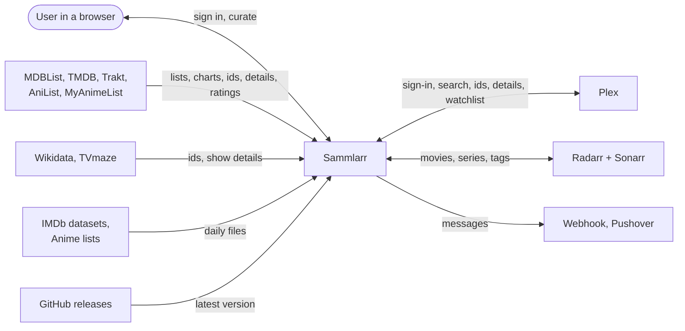

# 2. Context and Scope

Sammlarr sits between its users and a dozen media services. It reads lists, ids, details and ratings from them and
writes in only two places: the wantlist's sink (Plex, or Radarr + Sonarr) and the notification targets. Every media
service it calls is a member of `RemoteService` (`Domain/Providers/RemoteService.cs`), which also says how it is accessed.

## External Partners

One row per `RemoteService` member. Access (`RemoteServices.Access`) is one of four cases: `UserKey` (a key each user
adds in Settings › Providers), `UserSignIn` (the user's Plex account, signed in with or connected), `AppInstance` (a
Radarr or Sonarr the admin sets up) or `Open`.

| Partner       | Sammlarr reads                                                                                                               | Sammlarr writes                                                                                                           | Access                                            |
| ------------- | ---------------------------------------------------------------------------------------------------------------------------- | ------------------------------------------------------------------------------------------------------------------------- | ------------------------------------------------- |
| TMDB          | Trending, search, feeds (lists; movie, TV, discover, keyword, company or network pages), id conversion, details, TMDB rating | nothing                                                                                                                   | user key, required; optional read token for lists |
| Plex          | Sign-in, the account's name and avatar, search, id conversion, details, ratings (TMDB, IMDb, Rotten Tomatoes), the watchlist | watchlist adds and removes                                                                                                | user's Plex account                               |
| MDBList       | List feeds, id conversion, ratings from eight sources                                                                        | nothing                                                                                                                   | user key                                          |
| Wikidata      | For IMDb ids: TMDB, TVDB, Rotten Tomatoes, Metacritic, Letterboxd, AniList and MyAnimeList ids (SPARQL)                      | nothing                                                                                                                   | open                                              |
| TVmaze        | For a show's IMDb or TVDB id: its TVmaze id and details                                                                      | nothing                                                                                                                   | open                                              |
| IMDb datasets | `title.ratings.tsv.gz` daily: every title's IMDb rating and votes                                                            | nothing                                                                                                                   | open                                              |
| Anime lists   | Fribb's `anime-list-full.json` daily: AniList and MyAnimeList ids mapped to TVDB, TMDB and IMDb                              | nothing                                                                                                                   | open                                              |
| AniList       | Feeds (a user's list, a search page), details, AniList rating, the prequels that lead a later season to its show             | nothing                                                                                                                   | open                                              |
| MyAnimeList   | Feeds (a user's list, a top or season page), details, MyAnimeList rating                                                     | nothing                                                                                                                   | user key (client id)                              |
| Trakt         | Feeds (a watchlist, a public list, a trending, popular or anticipated chart), id conversion, details, Trakt rating           | nothing                                                                                                                   | user key (client id)                              |
| Radarr | Movies and tags, quality profiles, root folders, search lookups | adds movies, sets and removes tags, deletes a movie no other user or protection tag keeps (its files stay) | app instance |
| Sonarr | The same for series | the same for series | app instance |

How the two daily files load: [Cross-cutting Concepts](06-crosscutting.md). Every call to a `RemoteService` passes its
lanes ([Lanes and HTTP resilience](06-crosscutting.md#lanes-and-http-resilience)); key storage is in
[Cross-cutting Concepts](06-crosscutting.md).

Three partners sit outside `RemoteService`:

- **Notification targets**: a webhook URL or Pushover account each user sets up. Sammlarr sends a templated message per
  event.
- **GitHub releases**: the latest release of `Sammlarr:Release:GitHubRepo`, asked by a release build at most every 12
  hours, for the update notice in the footer and Settings › About.
- **Image hosts**: the browser loads artwork straight from TMDB, Plex, TheTVDB and the other services' hosts. Sammlarr
  only picks the size (`IArtworkResizer` in `API/Tmdb`, `API/Plex`, `API/Tvdb`). The one picture the server fetches
  itself is a person's profile picture, read once per URL to paint their avatar (`API/Pictures`).

## Sign-in and Sinks

The admin fixes `AuthProvider` once, by how they create the admin account at setup (`Core/Setup/OnboardingService.cs`,
`Core/Auth/SignInService.cs`):

- **Plex**: Plex's PIN flow on plex.tv. The token it returns is also the user's Plex access.
- **Local**: Sammlarr's own accounts, password hashes in its database, no external partner. Users can still connect a
  Plex account for the Plex sink or search.

`SinkKind` is where the wantlist syncs. The admin picks it at setup and can switch it in Settings › Providers.

- **Plex**: each user's own Plex watchlist.
- **Arr**: one Radarr for movies and one Sonarr for series, shared by the install. Sammlarr tags what it adds, by default
  per user and per feed, so each person reads back their own.

The sync, the tags and the switch are in the [Runtime View](04-runtime.md).

## Ids Without a Service

`MediaProvider` names id namespaces, not services ([ADR 0010](../../adr/0010-split-the-ids-from-the-services-sammlarr-calls.md)).
Sammlarr never calls TheTVDB, Rotten Tomatoes, Metacritic or Letterboxd. TVDB ids are identity keys other services
supply. The other three are page links only; their ratings come through MDBList, Rotten Tomatoes' also through Plex.
