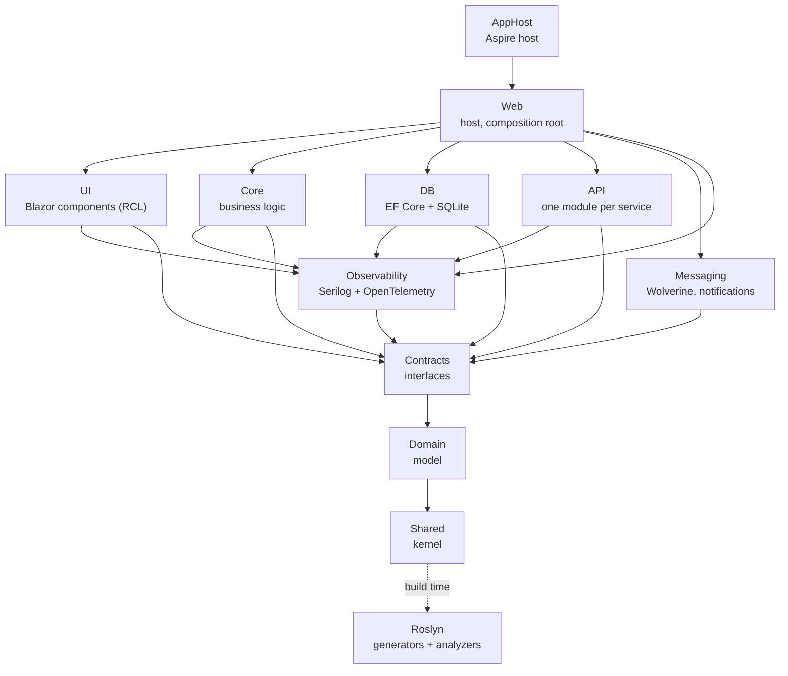

# 3. Building Block View

Sammlarr is twelve .NET projects in one solution, plus the tests. The idea to take away: dependencies point down
toward the kernel (`Shared`), and the implementations (`Core`, `DB`, `API`) and the presentation (`UI`) never reference
each other; they meet only through the interfaces in `Contracts`. `Web` is the one project that sees them all and
composes them.

## Whitebox Overall System

Arrows are `<ProjectReference>`s. Every project except `Contracts` and `Roslyn` also references `Shared` directly; those edges are
left out. `Roslyn` ships nothing at runtime: the root `Directory.Build.props` adds it to every other project as an
analyzer.

| Project         | What it holds                                                                                                                                                                                                                                                                                                                                                                                                                                           |
| --------------- | ------------------------------------------------------------------------------------------------------------------------------------------------------------------------------------------------------------------------------------------------------------------------------------------------------------------------------------------------------------------------------------------------------------------------------------------------------- |
| `Shared`        | The kernel, on no other project: the monads `Optional` and `Result`, `ValueSet`, the settings records bound from `appsettings.json` and environment variables (`src/Shared/Options`, .NET's options pattern), the async-stream helpers such as `BurstsAsync`, and the module infrastructure (`IServiceModule`, `AddModule<T>()`).                                                                                            |
| `Domain`        | The pure model, on `Shared` only: entities, value objects and unions for media, feeds, the wantlist and blocklist, providers (`RemoteService`, the role enums), jobs and notifications, and the strongly typed ids (`MediaId`, `FeedId`, `UserId`, one record struct per external id). No infrastructure. See [Cross-cutting Concepts](06-crosscutting.md).                                                                               |
| `Contracts`     | The seams: the service, repository and provider-role interfaces, the records they exchange, and the DI markers (`Keyed`, `Registered`, `ClientOf`). References `Domain` because its signatures use domain types.                                                                                                                                                                                                                                        |
| `Observability` | Serilog and OpenTelemetry setup, the in-memory log capture behind Settings › Diagnostics, the usage metrics, the feed-run spans, and the tracing proxies (`TracingProxy<T>`, a `DispatchProxy` that opens a span per call), registered through `AddTracedScoped` and `AddTracedKeyedScoped`.                                                                                                                                                                                      |
| `Core`          | The business logic behind the service interfaces: loading a list and identifying its titles (`src/Core/Media`), the query processor (filter, sort, limit), feeds and their runs, the wantlist and its sync, the blocklist, the job queue and runner, the TickerQ tickers (feed schedules, dataset loads, housekeeping), the `Announcer`, users, setup, ratings and usage reports.                                     |
| `DB`            | Persistence in one SQLite file ([ADR 0004](../../adr/0004-store-all-state-in-one-sqlite-file.md); WAL, busy timeout and compaction in [Persistence and housekeeping](06-crosscutting.md#persistence-and-housekeeping)): `SammlarrDbContext`, the row types, the repositories and the EF Core migrations, including the accounts on ASP.NET Core Identity (its tables, with `UserManager` and `SignInManager` behind the account ports, so `DB` references the ASP.NET Core framework), the job table, the media identity claims (`IdentityClaims`), the wantlist outbox and the usage store; the TickerQ store (`src/DB/Scheduling`); and the encryption of stored secrets with data protection (`src/DB/Conversion/Encryption`). |
| `API`           | One folder per external service, each with an `IServiceModule` ([Modules and dependency injection](06-crosscutting.md#modules-and-dependency-injection)) that registers its HTTP clients and the roles it serves, plus the lanes and HTTP pipeline every remote call passes and the webhook and Pushover channels. See [API: one module per provider](#api-one-module-per-provider).                                                                                                                                 |
| `Messaging`     | Wolverine with durable queues in the same SQLite file, for notifications only: `NotificationDispatchHandler` fans a notification out to its subscriptions and `NotificationDeliveryHandler` delivers each one, retried with cooldowns ([ADR 0008](../../adr/0008-separate-events-from-notifications.md)).                                                                                                                                               |
| `UI`            | The Blazor components as a Razor class library on BlazorBlueprint: one folder per feature under `src/UI/Features`, shared components and services under `src/UI/Shared`. References only `Contracts`, `Observability` and `Shared` ([ADR 0002](../../adr/0002-split-presentation-from-the-host.md)).                                                                                                                                                            |
| `Web`           | The ASP.NET Core host and composition root: the root components (`App`, `Routes`), `Program.cs`, the auth and health endpoints, the generated Tailwind CSS in `wwwroot`, and the `Dockerfile`.                                                                                                                                                                                                                                                          |
| `AppHost`       | The Aspire host: runs `Web` for development, staging and the E2E stacks. See [Deployment View](05-deployment.md).                                                                                                                                                                                                                                                                                                                                       |
| `Roslyn`        | Build time only. Source generators for the options registration (types marked `IOptionsSection`), the rating suppliers (`[SuppliedBy]` on `RatingSource`) and the async mirrors of the monad helpers (`[GenerateAsync]`); and the custom analyzers (see [Absence and failure](06-crosscutting.md#absence-and-failure-optional-result-or-null)).   |

The test projects under `tests/` (one per tier, plus shared harnesses and the architecture and analyzer tests) are
described in [Testing](../testing.md).

The rules that hold the graph together:

- `Core`, `DB` and `API` are siblings: none references another or `UI` (`tests/Architecture/DependencyTests.cs`
  checks it). To push the wantlist, `Core` calls the `IMediaSink` that `API` implements, resolved by its `SinkKind`.
- `UI` sees abstractions only: it works against the interfaces in `Contracts`, never an implementation.
- `Web` is the only place the implementations meet. `Program.cs` adds one module per layer with `AddModule<T>()`
  (`SharedModule`, `ObservabilityModule`, `DbModule`, `CoreModule`, `ApiModule`, `MessagingModule`, `UiModule`,
  `WebModule`). How modules and keyed services work: [Cross-cutting Concepts](06-crosscutting.md).

## Level 2

Two blocks are worth opening: `API`, where services plug in, and `UI` with `Web`, where features live.

### API: one module per provider

Each service Sammlarr calls has a folder under `API` with one module, added by `ApiModule`; how a module registers its
clients, roles, converter and enricher is in [Cross-cutting Concepts](06-crosscutting.md). Why a service takes every role its API offers: [ADR 0011](../../adr/0011-give-a-service-every-role-its-api-supports.md).

| Service | Folder (module) | Roles, by role enum member | Converter, enricher | Also registers |
|---|---|---|---|---|
| TMDB | `Tmdb` (`TmdbModule`) | key checks `ApiKeyProvider.Tmdb` and `ApiKeyProvider.TmdbReadToken`; `FeedProvider.Tmdb`; `TrendingProvider.Tmdb`; `SearchProvider.Tmdb` | `TmdbIdConverter`, `TmdbDetailsEnricher` | `TmdbArtwork` (artwork resizer) |
| Plex | `Plex` (`PlexModule`) | sign-in `AuthProvider.Plex`; `SearchProvider.Plex`; sink `SinkKind.Plex` | `PlexIdConverter`, `PlexApi` | `PlexArtwork`, `PlexUrls` |
| MDBList | `Mdblist` (`MdblistModule`) | key check `ApiKeyProvider.Mdblist`; `FeedProvider.Mdblist` | `MdblistIdConverter`, `MdblistEnricher` | `MdblistTitles` (burst primer), `MdblistBudget` (lane quota) |
| Wikidata | `Wikidata` (`WikidataModule`) | none | `WikidataIdConverter` | |
| TVmaze | `Tvmaze` (`TvmazeModule`) | none | `TvmazeIdConverter`, `TvmazeEnricher` | |
| IMDb datasets | `Imdb` (`ImdbModule`) | none | `ImdbFileEnricher` | `ImdbRatingsFile` (dataset), `ImdbRatingsInRun` (burst primer) |
| Anime lists | `Anime` (`AnimeListsModule`) | none | `AnimeListsIdConverter` | `AnimeIdsFile` (dataset), `AnimeIdsInRun` (burst primer), `LaterSeasons` (reads and writes `IShowParts`) |
| AniList | `AniList` (`AniListModule`) | `FeedProvider.AniList` | `AniListEnricher` | `AniListTitles`, `AniListPrequels` (`IAnimePrequels`) |
| MyAnimeList | `Mal` (`MalModule`) | key check `ApiKeyProvider.Mal`; `FeedProvider.Mal` | `MalEnricher` | |
| Trakt | `Trakt` (`TraktModule`) | key check `ApiKeyProvider.Trakt`; `FeedProvider.Trakt` | `TraktIdConverter`, `TraktEnricher` | `TraktTitles` |
| Radarr, Sonarr | `Arr` (`ArrModule`) | through `ForService`: sink `SinkKind.Arr` (`ArrSink`); `SearchProvider.Arr` (`ArrSearch`) | none | `RadarrApi`, `SonarrApi`, `IArrConnectionTester` |

A dataset is a file loaded daily into a table ([ADR 0013](../../adr/0013-load-shared-datasets-outside-the-job-queue.md)).
Which converter and enricher a title gets: [Provider routing](06-crosscutting.md#provider-routing); what each service
answers: [Context and Scope](02-context-scope.md). Id sources Sammlarr never calls (TheTVDB, Rotten Tomatoes,
Metacritic, Letterboxd) get no client ([ADR 0010](../../adr/0010-split-the-ids-from-the-services-sammlarr-calls.md));
`src/API/Tvdb` only sizes TheTVDB's artwork.

At the root, `ResilienceModule` adds `HttpModule` (the lanes and `IRemoteCapacity`) and sets the log level of
resilience events.

### UI and Web: feature slices, and the host that composes them

`src/UI/Features` has one folder per feature area, each a vertical slice of pages and components:

| Folder | Routes | What it is |
|---|---|---|
| `Home` | `/` | The dashboard. |
| `Browse` | `/browse` | Trending titles. |
| `Feeds` | `/feeds`, `/feeds/create`, `/feeds/edit/{id}`, `/feeds/clone/{id}`, `/feeds/{id}/runs`, `/feeds/{id}/runs/{runId}` | The feed list, the editor, the run history and the live run view. |
| `Wantlist` | `/wantlist` | The wantlist and its sync. |
| `Blocklist` | `/blocklist` | The blocked titles. |
| `Auth` | `/signin`, `/join/{user}?token=…`, `/reset/{user}?token=…` | Sign-in, joining through an invite link, choosing a new password. |
| `Onboarding` | `/setup`, `/welcome` | The first-run wizard (admin and sign-in method, sink, keys, people) and a new member's prompt for a TMDB key. |
| `Settings` | `/settings` | One section per settings area; Testing only in Debug builds. |

`src/UI/Shared` holds what the features share: layout and guards, the media grid, detail sheet and global search
(`src/UI/Shared/Media`), branding and avatars, the signed-in user of a circuit (`src/UI/Shared/Identity`), the web UI
notification channel, and services such as the external page linkers.

`Web` is the host. Its `Program.cs` adds the modules, then TickerQ (`AddSammlarrScheduling`, from `DB`) and Wolverine
(`UseSammlarrMessaging`, from `Messaging`). Its middleware includes `FirstRunRedirect`, which sends every page to
`/setup` until an admin exists. It maps the Razor components in interactive server mode (with `UI`'s assembly added so
its pages are routed), the auth endpoints under `/auth` (`src/Web/Auth/AuthEndpoints.cs`), `/health` and `/alive`, and the admin-only
`/diagnostics/export`. `src/Web/Staging` (the staging seed) is left out of published builds.

## Level 3

### Where a feature lives

A feature area keeps one folder name across `Domain`, `Contracts`, `Core` and `src/DB/Data`, with the exceptions in the table;
the last column is its UI home:

| Area                          | `Domain`           | `Contracts`        | `Core`             | `src/DB/Data`            | `UI`                                 |
| ----------------------------- | ------------------ | ------------------ | ------------------ | -------------------- | ------------------------------------ |
| Feeds                         | `Feed`             | `Feed`             | `Feed`             | `Feed`               | `Features/Feeds`                     |
| Wantlist and sinks            | `Wantlist`         | `Wantlist`         | `Wantlist`         | `Wantlist`           | `Features/Wantlist`                  |
| Titles: loading, ids, details | `Media`            | `Media`            | `Media`            | `Media`              | `src/Shared/Media`                       |
| Background jobs               | `Jobs`             | `Jobs`             | `Jobs`             | `Jobs`               | `Features/Home`                      |
| Sign-in and users             | `Auth`, `Identity` | `Auth`, `Identity` | `Auth`, `Identity` | `Auth`, `Identity`   | `Features/Auth`, `Features/Settings` |
| Notifications                 | `Notifications`    | `Notifications`    | `Notifications`    | `Notifications`      | `Features/Settings`                  |
| Usage                         | `Usage`            | `Usage`            | `Usage`            | `Usage`              | `Features/Settings`                  |
| Housekeeping                  |                    | `Housekeeping`     | `Housekeeping`     | `Housekeeping`       | `Features/Settings`                  |

Notifications also live in `Messaging` and `API`, usage in `Observability`. The flows that cross these folders are in the
[Runtime View](04-runtime.md).

What a provider folder holds and how its module registers: [Cross-cutting Concepts](06-crosscutting.md#providers-registration-and-extension).
