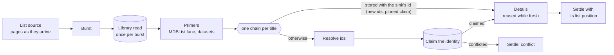
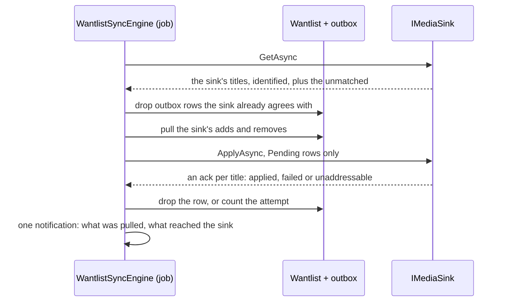
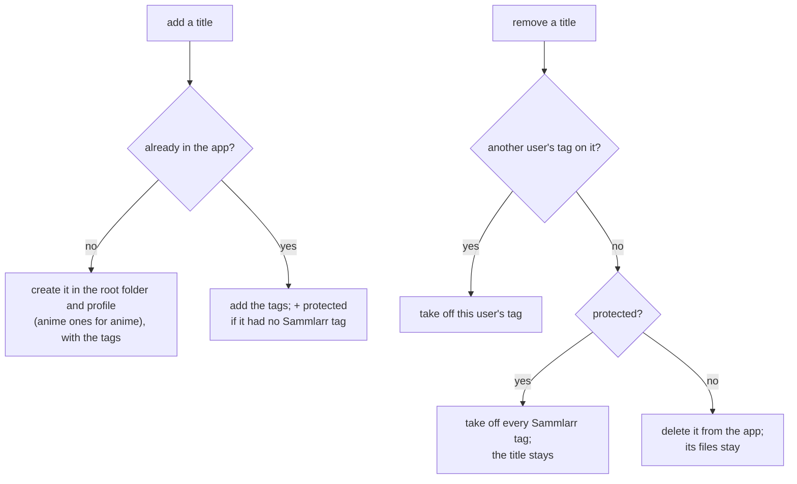

# 4. Runtime View

This chapter walks through the flows that do Sammlarr's work: loading a list, previewing a feed, running a feed
through the job queue, syncing the wantlist to its sink, and switching that sink. The idea to take away: every list
goes through one list load, which claims each title's identity before handing it out, and a wantlist change reaches
Plex, Radarr or Sonarr only through the outbox that a wantlist sync drains (clearing a removed person's titles is the
one direct write).

## Loading a list

A list load turns a list's entries (ids with title hints) into library titles that hold the id the active sink adds
them by. A wrong match corrupts every list the title is on. A feed service streams its entries into
`IMediaService.LoadListAsync` (`Core/Media/ListLoad.cs`), which hands each title back with its list position as soon
as it settles.

### Bursts and chains

A _burst_ is what the source yields without waiting (`BurstsAsync`), such as one page of a list. For each burst,
`ListLoad` reads the library once (`IMediaRepository.GetByExternalsAsync`), then hands the burst to the primers
(`BurstPrimers`), each asked only for a service the user has connected, and only while its lane would take the ask in
time. MDBList's primer queues the titles that need
its fields on its batching lane and returns at once, so a blocked MDBList never holds a burst up; the IMDb ratings
file and the anime id map are read once for the burst.

Each title then runs its own _chain_ (`ListLoad.SettleAsync`) under `LaneClass.Title`, numbered in list order, so
earlier titles go first at every lane ([Lanes and HTTP resilience](06-crosscutting.md#lanes-and-http-resilience)).
Nothing caps the chains: the lanes pace each service, and a title that needs nothing from a slow service never waits
for it.

A chain settles exactly once, in its `finally`: matched, not found, not found earlier, couldn't look up, or conflict.
A media type the sink cannot address settles not found. A chain that throws settles couldn't look up, and the load
rethrows once all have settled, so a feed run records the load as unfinished. When no title has settled for
`Sammlarr:FeedLoad:StallAfter` (3 minutes), a `RunWatchdog` cancels the open chains, which settle couldn't look up. Each load runs in a DI scope of
its own, so its per-load memos (`MdblistTitles`, `TmdbApi` and the like) start empty.

### Ids and the claim

`TitleIdentifier` starts from the stored titles the entry's ids hit:

- **Two or more:** the ids go to an unpinned claim, which conflicts.
- **One that holds the sink's id:** the title is known. Ids the list adds go to it through a claim pinned to it.
- **Otherwise:** `MediaIdResolver` resolves the sink's id from the list's ids plus the stored title's keys and hints,
  and the result is claimed, pinned to the stored title if there is one.

The target is the provider the active sink addresses the media type by (`IMediaSink.AddressedBy`): Plex on Plex;
TMDB for movies and TheTVDB for shows on Radarr + Sonarr. The resolver asks every free lookup once (a downloaded table
such as the anime id map), then tries the paths of id lookups to the target, cheapest first
([Provider routing](06-crosscutting.md#provider-routing)). A title settles not found only when every path answered
that there is no such title; its ids are then cached as unmatched for an hour, and a repeat settles not found earlier
without a call. A path whose service is down, blocked past its `MaxWait`, refused or faulted gives up, and the resolver
tries the next one. When no path finds the id and one gave up, the title settles couldn't look up and nothing is
cached, so the next load asks again
([Risks and Technical Debt](08-risks-technical-debt.md)).

A title is claimed before it is handed out (`IIdentityClaims.ClaimAsync`,
[ADR 0018](../../adr/0018-claim-identity-before-hand-out-from-identity-keys-only.md)), from its identity keys only.
The claim lane (`IdentityClaims`, one per scope) commits every claim queued meanwhile in one transaction under the
media write lock and decides each with the pure `ClaimRule`, whose rules are in
[Cross-cutting Concepts](06-crosscutting.md). A conflicted title settles as a conflict (with `ConflictsWith`), and both
stored titles stay as they are; a claim that meets two stored titles notes the pair as stored twice for housekeeping.

### Details

`DetailsFetcher` fills the title's details for the load's field needs (`FieldNeeds`: what the feed filters or sorts
on, and what a card shows).

- **Reuse.** A stored copy is used as it is unless it is stale (`Sammlarr:Housekeeping:FreshDays`, 14 days) or a
  needed field is missing that a connected enricher, not resting, could fill in time.
- **Ask.** A new or stale title aims at every field a card shows, a gap fill only at the needed fields. Enrichers are
  asked one at a time, in the [Provider routing](06-crosscutting.md#provider-routing) order, until none left can fill
  what is missing. A field a card only shows is asked only from a service that answers within
  `Sammlarr:FeedLoad:ShownWait` (5 seconds).
- **Merge.** Each answer wins over the stored copy, an earlier answer over a later one. A stale refresh keeps a stored
  value only where a provider gave it within the last `FreshDays`, so a value gone upstream goes with the next
  refresh, or where the service that fills it could not be asked.
- **Record.** The copy keeps who answered and what each could not give (`ProviderAnswer`). Keys an answer adds are
  claimed, pinned to the title, and `LibraryWriter` writes the changes as the load goes, at most 256 titles per
  transaction.

When no enricher answers, a stored copy goes out as stored, flagged `Stale` when it is due and a service could not be
reached. A title with no stored details goes out with the list's own title when it is already in the library or a
service was unreachable, and settles not found only when it is new and every enricher said no match.

## Feed preview

The feed editor (`FeedPreviewPanel`) streams the feed through `IFeedProvider.GetFeedItemsAsync`, which runs the list
load, and plans the items so far with `IFeedRunPlanner.PlanAsync(DraftFeed(...))`, the planner a run uses, so preview
and run cannot disagree. The plan is never saved; the titles and details the load claims and fetches are stored like
any load's.

- List pages are read at `LaneClass.Source` (`API/Http/SourcePages.cs`), ahead of every title at the same lanes.
- The planner (`Core/Feed/FeedRunPlanner.cs`) reads the wantlist, the blocklist and the titles this feed added,
  classifies the rows against the feed's filter, sort and limit (each row carrying the feed's Sammlarr rating), and
  hands them to the pure `FeedPlans.Compute`.
- The panel re-plans after items 1, 2, 4, 8 and so on, then once at the end, which keeps the total work linear in the
  list's length.
- A plan made before the load ends passes `FeedLoadState.Unfinished`, so the planner reports `StillLoading` and
  removes nothing: a title missing from a list still loading has not left it. When a page's service is unavailable,
  the panel shows what arrived with a retry and keeps planning it as unfinished.
- Leaving the editor cancels the load and its re-plans.

## Feed runs and the job queue

Feed runs, wantlist syncs and the FillDetails job never run where they are requested: each request becomes a row in
the `Jobs` table (`IJobQueue`), and one hosted `JobRunner` takes the row due first, one at a time, in a fresh DI scope
as the row's owner ([ADR 0006](../../adr/0006-run-background-work-through-one-job-queue.md); the queue's rules are in
[Cross-cutting Concepts](06-crosscutting.md)). TickerQ owns only the _when_: each scheduled feed has one cron ticker,
keyed by its feed id, that enqueues a `RunFeed` as the feed's owner.

| Job | Queued by | Due |
|---|---|---|
| `RunFeed` | the cron ticker, Run on the Feeds page | at once; folds into that feed's pending or running run |
| `SyncWantlist`, armed | a scheduled run, or a manual one with _sync when done_, when queued and as it starts | `Grace` (2 minutes) later, pushed back by each such run, never past `MaxWait` (30 minutes) after its first due time |
| `SyncWantlist`, manual | Sync on the Wantlist page | at once: a pending sync's deadline moves to now |
| `FillDetails` | every feed run, storing an API key or a sign-in | `FillDetailsGrace` (5 minutes) later, then only while no one's feed run or sync is queued or waiting, or once `FillDetailsMaxWait` (30 minutes) past due |

The durations are `Sammlarr:Scheduler` settings (`Shared/Options/SchedulerOptions.cs`). A sync or fill folds into the
owner's pending one, so N runs in a window produce one sync, and a feed that adds a title and another that removes it
cancel out in the outbox before anything reaches the sink.

While an arming run is queued, the owner's sync is queued behind it; when the run starts it arms the sync again and
the grace starts over. A plain manual run neither arms nor holds the sync.

### The run

`FeedRunEngine` (`Core/Feed/FeedRunEngine.cs`):

1. opens the run's live trace and saves the run as `Pending`, which the Feeds page shows
   ([ADR 0016](../../adr/0016-live-runs-pull-from-an-in-memory-trace.md));
2. plans through the preview's planner;
3. adds the planned titles to the wantlist, recording one the sink cannot address as unaddressable instead of failing,
   and removes the owned titles the plan drops, each change queued in the outbox;
4. completes the run row in every case, with its counts and calls; a run that throws or is cancelled ends `Stopped`,
   and startup marks a `Pending` run a crash left behind `Stopped`.

An `Append` feed only adds. A `Mirror` feed also removes the titles it added once they leave the list. A load is
conclusive only when it finished, at least one title passed the filter, and no title settled couldn't look up; anything
else removes nothing. An owned title missing from a conclusive run counts a miss (`FeedAbsences`) and is removed after
the feed's absence threshold of misses. A title in conflict counts as seen, and one served `Stale` is not counted
missing.

### FillDetails

The `FillDetails` job fills the missing fields of the owner's wantlisted and blocklisted titles: the details step only,
500 titles a page, at `LaneClass.Background`, asking only services that answer within `ShownWait`. Between pages it
requeues itself whenever another job is queued.

## Wantlist sync

Adding a title and sending it to the sink are two steps
([ADR 0007](../../adr/0007-push-watchlist-changes-inline-during-sync.md)). An add or a remove writes the wantlist and
queues the change in the outbox for the active sink; the next sync pushes it. The sync works the same on either sink
through `IMediaSink`, and a per-user gate keeps two syncs for one user from overlapping.

- **Queueing.** An add cancels a queued removal and a removal cancels an add not yet pushed, so opposing changes never
  reach the sink. A title the sink cannot address is not added.
- **Pull.** The sink's titles are identified like list entries (ids and the claim, no details). One not on the
  wantlist, and not queued for removal, is added; a wantlist title missing from the sink, and not queued as an add,
  is removed.
- **Push.** Five attempts, one per sync; the fifth failure marks the row `Failed`. That is terminal: no sync pushes it
  again. Every sync still counts it as intent, so an abandoned add is not read as a removal in the sink. An
  unaddressable title is abandoned at once. Per-title status reaches an open page as in-process events.

| | Plex | Radarr + Sonarr |
|---|---|---|
| A sync reads | the user's own Plex watchlist | each app's titles carrying the user's tag ([next section](#radarr--sonarr-tags-mark-whose-a-title-is)) |
| A push | one PUT per title, by its Plex id | add: tag or create; remove: untag or delete |
| Unaddressable | no Plex id | no TMDB id (movies) or TheTVDB id (shows), or the app does not know the title |

A sink that cannot be read stops the sync, which announces the failure. On Radarr + Sonarr, when only one app can be
read, the sync plans just the titles of the answering app's type: the down app's titles stay out of the pull (else
they would look removed) and out of the push (their rows wait, no attempt counted), and the sync announces the down
app.

## Radarr + Sonarr: tags mark whose a title is

Radarr and Sonarr have no watchlist, so Sammlarr marks the titles it manages with tags (`ArrTagScheme`, set in
Settings › Providers › Radarr + Sonarr; pushes in `API/Arr/ArrSink.cs`). Every tag starts with the prefix (default
`sammlarr`, slugged to `a-z0-9-`), and a title is Sammlarr's when one of its tags does. A sync reads only the titles
carrying the current user's tag and leaves everything else in the apps alone.

| Tag | Example | When it is set |
|---|---|---|
| user | `sammlarr-u-dario` | per user, on by default; from the user's name or the first 8 hex digits of their id (a sync recognises both); forced on while Sammlarr has more than one user |
| feed | `sammlarr-top-rated-2024` | per feed, on by default, on titles a feed added; the feed's name or id; a label for people, nothing reads it; a name that would clash with `u-` or the protection word becomes `sammlarr-f-…` |
| plain | `sammlarr` | optional, one filter for everything Sammlarr added; always set while per-user tags are off |
| protected | `sammlarr-protected` | set by Sammlarr when it tags a title the app already had with no Sammlarr tag |

- Anime (an AniList or MyAnimeList id, an anime id map entry, or the app's own lookup) goes to the app's anime root
  folder and profile when one is set. A title the app's lookup does not know acks unaddressable.
- With per-user tags off (one user only), a sync reads every title with a Sammlarr tag.
- Unclaimed titles, those with a Sammlarr tag but no user tag (tagged while per-user tags were off), are read into the
  wantlist of the user who joined first, and get that user's tag on their next add.
- Removing a person (Settings › Users) can also clear their titles: it deletes the titles only they hold that aren't
  protected and takes their tag off the rest. It needs per-user tags; on Plex it is refused, since a Plex watchlist
  belongs to its account.

## Switching the sink

Switching between Plex and Radarr + Sonarr (`ISinkSwitch`, `Core/Wantlist/Sync/SinkSwitch.cs`) is for admins; a
switch to Radarr + Sonarr needs each app's address, API key, quality profile and root folder. The switch holds every
user's sync gate throughout and refuses while a sync runs. Then:

1. under each user, it gives every wantlist and blocklist title the id the new sink addresses it by
   (`EnsureSinkIdsAsync`, from the ids the title already carries);
2. under each user, it queues every wantlist title as an add for the new sink, beside the old sink's rows, replacing
   rows queued earlier for that sink;
3. it stores the new sink, queues each user's wantlist once more (a title added during the switch went to the old
   sink's queue), then drops each user's rows for other sinks.

An outbox row is keyed by user, title and sink, and a sync reads and drains only the active sink's rows. So a removal
queued before the switch never reaches the new sink, and a switch that fails before storing the sink leaves the old
queue as it was. Without the queued adds, the first sync would find none of the titles in the new sink and pull them
all off the wantlist. A title no lookup can convert is counted and acks unaddressable on its first push. Moving Radarr
or Sonarr to another address runs the same steps on the same sink: it queues every wantlist title as an add again and
drops nothing.
