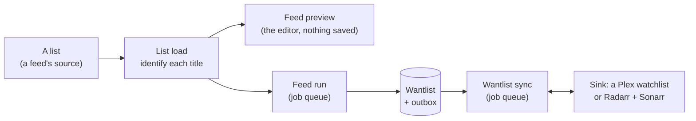
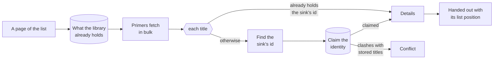
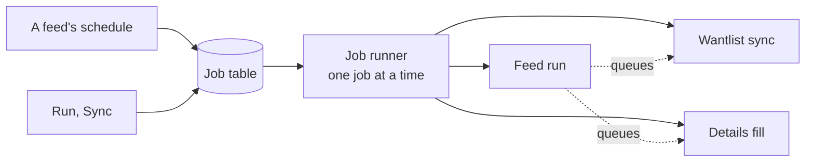
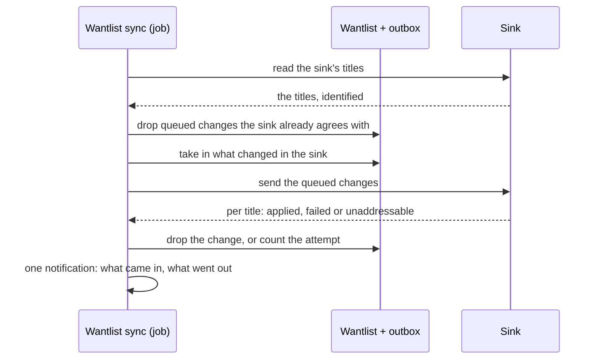
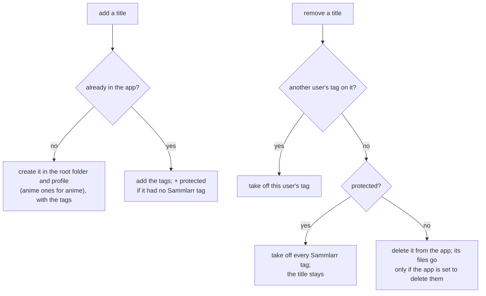

# 4. Runtime View

This chapter follows the paths that do Sammlarr's work. The idea to take away: every list goes through one list load,
which settles each title's identity before handing it out, and a wantlist change reaches Plex, Radarr or Sonarr only
through the outbox that a wantlist sync drains.

## Loading a list

A list arrives as entries: a few ids and a title hint each. The load turns each entry into a title in Sammlarr's
library that carries the id the active sink adds it by: Plex's own id on Plex; TMDB for movies and TheTVDB for shows
on Radarr + Sonarr. A wrong match would corrupt every list the title is on, so a title is handed out only once its
identity is settled (`src/Core/Media/ListLoad.cs`).

### Bursts and chains

The list is read page by page, and each page is a _burst_. For each burst the load asks the library once which of its
titles it already holds. Then the _primers_ run: a primer fetches in bulk what many titles of the burst will need, so
their own steps find it at hand instead of asking one by one. MDBList's primer sends up to 200 titles per request; the
IMDb ratings file and the anime id map, both downloaded daily, are read once per burst. A primer only asks a service
the user has connected and that is not blocked, and never holds the burst up.

Then each title runs its own _chain_: find its id, claim it, fill its details. All chains run at once. The lanes pace
each service ([Lanes and HTTP resilience](06-crosscutting.md#lanes-and-http-resilience)) and every title queues at a
lane in list order, so the top of a list comes back first, and a title that needs nothing from a slow service never
waits for it.

Each chain ends with exactly one outcome:

| Outcome | When |
|---|---|
| Matched | The title holds the sink's id and its details are filled. |
| Not found | Every service answered that there is no such title, or the sink cannot take its media type. Remembered for an hour. |
| Not found earlier | That hour-long memory answered; no service was asked. |
| Couldn't look up | A service it needed was down, blocked too long or failed. Nothing is remembered, so the next load asks again. |
| Conflict | Its ids point at two different stored titles. |

If the whole load stalls, so that no title at all settles for 3 minutes (`Sammlarr:FeedLoad:StallAfter`), every title
still open settles couldn't look up. A single slow title has no limit of its own while others keep settling; its calls
are bounded by the HTTP timeout (30 minutes). A chain that throws settles couldn't look up, and the load is recorded
as unfinished.

### Ids and the claim

Finding the sink's id starts from what the library holds:

- The entry's ids hit one stored title that already holds the sink's id: the title is known, and any new ids the list
  brings are added to it.
- They hit two or more stored titles: conflict.
- Otherwise the load looks the id up from the ids it has, cheapest way first: the downloaded tables, then chains of up
  to three lookups across the services. A busy service counts as more expensive, and one that is down or blocked too
  long is skipped for the next way.
- An anime list's later season, part or special is asked as its show: the anime id map names its TheTVDB show, or
  else AniList's earlier season leads to it. Once the show is matched, the season is stored with it as a show part, so
  the next load goes straight to the show. When AniList's answer leads to no show, that answer is kept for
  `NoPrequelDays` (3, in the housekeeping settings) and AniList is not asked again until then; a failed ask is not kept.

| Service | Turns these ids into those | Cost in calls |
|---|---|---|
| Anime lists | AniList, MyAnimeList into those, TheTVDB, TMDB, IMDb; TheTVDB, TMDB, IMDb into AniList, MyAnimeList | 0 |
| Plex | TMDB, IMDb, TheTVDB into Plex (one ask answers for all of them); Plex into TMDB, IMDb, TheTVDB | 1 |
| TMDB | TMDB into IMDb, TheTVDB; IMDb, TheTVDB into TMDB | 1 |
| Trakt | Trakt, IMDb, TMDB, TheTVDB into the same four | 1 |
| TVmaze | IMDb, TheTVDB into TVmaze, TheTVDB, IMDb | 2 |
| MDBList | IMDb, TMDB, TheTVDB, Trakt, MyAnimeList into the same and MDBList | 2 |
| Wikidata | IMDb into TMDB, TheTVDB, AniList, MyAnimeList and rating site pages | 3 |

Before a title is handed out its identity is claimed
([ADR 0018](../../adr/0018-claim-identity-before-hand-out-from-identity-keys-only.md)): its ids are written to the
library under one lock, so two loads that meet the same title at once end up with one stored title, not two. A claim
that would put one id on two stored titles is refused. The title settles as a conflict, both stored titles stay as
they are, and housekeeping notes the pair for review.

### Details

The details step fills what the feed filters or sorts on and what a card shows.

- A stored copy is reused while it is fresh, 14 days after its last refresh (`FreshDays` in the Housekeeping
  settings), as long as nothing the load needs is missing.
- Otherwise services are asked one at a time, open ones first, until nothing needed is missing. A field a card only
  shows is asked only from a service that answers within 5 seconds, so a slow service never holds a title up for
  decoration.
- Each service's answer is remembered per title: one that answered is not asked again for 14 days; one that failed
  waits 1, 6, then 24 hours.
- A fresh answer wins over the stored copy. Changes are written as the load goes, in batches.

When no service can answer, a stored copy goes out as it is, marked stale so the next load tries again. A new title
that every service says it does not know settles not found.

## Feed preview

The feed editor runs the same list load and plans the result with the planner a feed run uses, so preview and run
cannot disagree. The plan is never saved; the titles and details the load fetched are stored like any load's. The
editor re-plans as titles arrive (after 1, 2, 4, 8 and so on, then at the end). While the list is still loading the plan
removes nothing, since a title missing from an unfinished list has not left it. Leaving the editor cancels the load.

## Feed runs and the job queue

Feed runs, wantlist syncs and the details fill never run where they are asked for. Each becomes a row in the job
table, and one runner takes the row due first, one at a time, as the row's owner
([ADR 0006](../../adr/0006-run-background-work-through-one-job-queue.md)). TickerQ only decides _when_: a scheduled
feed has a cron ticker that queues its run.

| Job | Queued by | Runs |
|---|---|---|
| Feed run | its schedule, or Run on the Feeds page | at once; a second request joins the pending or running one |
| Wantlist sync | a scheduled run, or a manual one with _sync when done_ | 2 minutes later, pushed back by each further such run, at most 30 minutes after it was first due |
| Wantlist sync | Sync on the Wantlist page | at once |
| Details fill | every feed run, a new API key or sign-in | 5 minutes later, and only while no feed run or sync waits, at most 30 minutes late |

So a burst of scheduled runs produces one sync, and a title one feed adds while another removes it cancels out before
anything reaches the sink. The durations are `Sammlarr:Scheduler` settings.

### The run

A feed run loads the list, plans it with the preview's planner, adds the planned titles to the wantlist and removes the
ones the plan drops, each change queued in the outbox, then records the run with its counts. An Append feed only adds;
a Mirror feed also removes the titles it added once they leave the list. Removing needs a conclusive load: it finished,
at least one title passed the filter, and no title settled couldn't look up. A title missing from a conclusive run
counts a miss and goes after the feed's threshold of misses. A run that fails or is cancelled ends Stopped. The live
view on the Feeds page reads the run's in-memory trace
([ADR 0016](../../adr/0016-live-runs-pull-from-an-in-memory-trace.md)).

### FillDetails

The details fill completes the missing details of the owner's wantlisted and blocklisted titles, 500 at a time, behind
every other kind of work at each lane, and steps aside whenever another job is queued.

## Wantlist sync

Adding a title and sending it to the sink are two steps
([ADR 0007](../../adr/0007-push-watchlist-changes-inline-during-sync.md)). An add or a remove changes the wantlist and
queues the change in the outbox for the active sink; the next sync sends it. The sync works the same on either sink,
and two syncs for one user never overlap.

- **Queueing.** An add cancels a queued removal of the same title and a removal cancels an unsent add, so opposing
  changes never reach the sink.
- **Taking in.** A title added in the sink itself joins the wantlist; one removed there leaves it, unless a change for
  it is queued.
- **Sending.** A queued change is tried once per sync, five times at most; after the fifth failure it is marked failed
  and left alone. A title the sink cannot address is dropped at once.

| | Plex | Radarr + Sonarr |
|---|---|---|
| A sync reads | the user's own Plex watchlist | each app's titles carrying the user's tag ([next section](#radarr--sonarr-tags-mark-whose-a-title-is)) |
| Sending | one request per title, by its Plex id | add: tag or create; remove: untag or delete |
| Cannot address | a title with no Plex id | a title with no TMDB id (movies) or TheTVDB id (shows), or one the app does not know |

A sink that cannot be read stops the sync, which says so. On Radarr + Sonarr, when only one app answers, the sync
handles that app's titles and leaves the other's queued changes waiting.

## Radarr + Sonarr: tags mark whose a title is

Radarr and Sonarr have no watchlist, so Sammlarr marks the titles it manages with tags (set in Settings › Providers ›
Radarr + Sonarr). Every tag starts with the prefix (default `sammlarr`), and a sync reads only the titles carrying the
current user's tag, leaving everything else in the apps alone.

| Tag | Example | When it is set |
|---|---|---|
| user | `sammlarr-u-dario` | per user, on by default, from the user's name; always on while Sammlarr has more than one user |
| feed | `sammlarr-top-rated-2024` | per feed, on titles a feed added; a label for people, nothing reads it |
| plain | `sammlarr` | optional, one filter for everything Sammlarr added; always set while per-user tags are off |
| protected | `sammlarr-protected` | set when Sammlarr tags a title the app already had without a Sammlarr tag |

- Titles tagged while per-user tags were off belong to the user who joined first.
- Removing a person (Settings › Users) can also clear their titles: the ones only they hold go unless protected, and
  their tag comes off the rest. On Plex this is refused, since a watchlist belongs to its Plex account.

## Switching the sink

An admin can switch between Plex and Radarr + Sonarr; Radarr + Sonarr needs each app's address, API key, quality
profile and root folder. No sync runs during a switch. For every user the switch gives each wantlist and blocklist
title the id the new sink addresses it by, queues the whole wantlist as adds for the new sink, then makes the new sink
active and drops the queued changes for the old one.

Without those queued adds, the first sync would find none of the titles in the new sink and take them all off the
wantlist. Queued changes belong to one sink, so a removal queued before the switch never reaches the new one, and a
switch that fails part way leaves the old sink as it was. Moving Radarr or Sonarr to another address runs the same
steps on the same sink.
