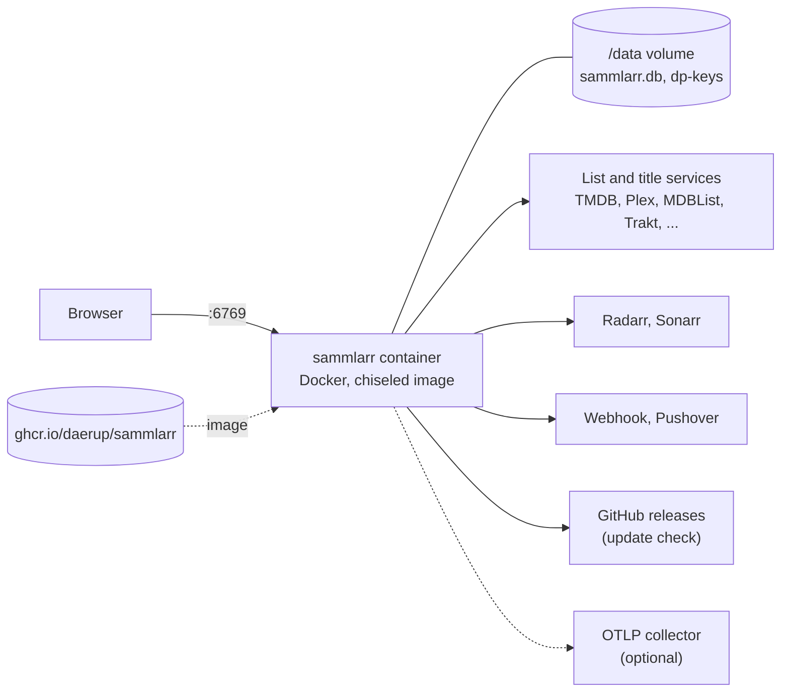
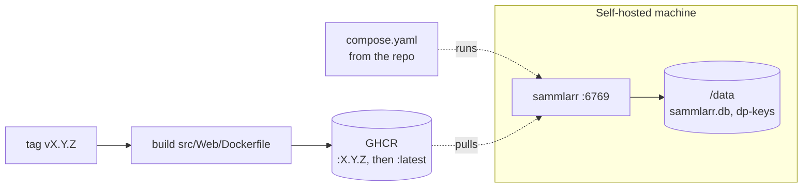

# 5. Deployment View

Sammlarr runs as one process with one SQLite file. The Aspire AppHost (`src/AppHost/AppHost.cs`) starts it for development
and staging; a self-hoster runs the released image with the repo's `compose.yaml`. The idea to take away: in the
container, all state lives in one `/data` folder, the database and the key ring that decrypts its secrets.

| | Dev run | Staging | Release |
|---|---|---|---|
| Started by | `aspire run`, or Rider's `AppHost: http` | `dotnet run --project AppHost -c Staging --launch-profile staging` | a `v*` tag |
| Sammlarr runs as | the `Web` project | an image built from `src/Web/Dockerfile` | `ghcr.io/daerup/sammlarr` |
| App | http://localhost:6769 | http://staging.localhost:6789 | port 6769 |
| Dashboard | http://localhost:15223 | http://localhost:15224 | none |
| Data | `src/Web/sammlarr.db`, `src/Web/dp-keys` | `%LOCALAPPDATA%\Sammlarr\staging` | the `sammlarr-data` volume at `/data` |

## The deployed system

One container, one volume. Sammlarr only calls out: to the services it reads, the Radarr and Sonarr it writes to, the
notification targets each user sets up, GitHub for the update check, and an OTLP collector when one is configured.

## Dev run and staging

The AppHost's `http` profile (`src/AppHost/Properties/launchSettings.json`) sets `ASPIRE_ALLOW_UNSECURED_TRANSPORT=true`,
so a bare `aspire run` needs no https. `AppHost.cs` pins the port, logs at `Verbose` and opens a browser when
`LaunchSammlarr` is true, which `src/AppHost/appsettings.Development.json` sets; `RadarrSonarr=true` adds throwaway Radarr and
Sonarr containers. `dotnet build` of `Web` runs `npm ci` and `npm run css`, so building needs Node 24.

Staging is a seeded Sammlarr for trying things by hand: its own image, real Radarr and Sonarr, WireMock in place of Plex
and an indexer, and a webhook catcher (`src/AppHost/Staging`). Guide: [Testing › Staging](../testing.md#staging).

## The container

`src/Web/Dockerfile`:

- **Build**: the .NET 11 SDK with Node 24 for the Tailwind build; `dotnet publish -p:ExcludeStaging=true` leaves the
  staging seed out. The build stages run on the build machine's platform and `-a $TARGETARCH` cross-compiles, so the
  arm64 image builds without emulation ([ADR 0024](../../adr/0024-build-the-image-for-amd64-and-arm64-on-one-runner.md)).
  Base images are pinned by digest; the commit time as `SOURCE_DATE_EPOCH` and BuildKit's `rewrite-timestamp` keep
  build times out of the image, so a rebuild of a tag can reach the same digest
  ([ADR 0023](../../adr/0023-push-an-unsigned-image-by-version-and-move-latest-last.md)).
- **Runtime**: `aspnet:11.0-resolute-chiseled-extra` (no shell, ICU and tzdata included), running as `$APP_UID`
  (1654), which owns `/data`. Plain HTTP on 6769.
- **Health**: `HEALTHCHECK` runs `dotnet Web.dll healthcheck`, which asks `/alive` (the process and the job runner's
  liveness) and exits 0 or 1 (`src/Web/Health/ContainerHealthProbe.cs`).

| Image property | Today |
|---|---|
| Reproducible | yes: base images pinned by digest, `SOURCE_DATE_EPOCH` and `rewrite-timestamp` (see Build), and one BuildKit for every image build, pinned by version and digest in `.github/actions/build-image`; each release rebuilds its tag on a fresh runner and fails when the index digest or either platform's `/app` differs, and a match adds the image, linked to its package version, with the digest and the BuildKit version to the release notes (`release.yml`, jobs `rebuild` and `reproduced`) |
| Signed, attested | attested, not signed: the `image` job attests the index's build provenance with `actions/attest` and keeps it out of GHCR, which has no referrers API and would show it as one more tagged version; it is on the repository's attestations page and on the release as `sammlarr-image.intoto.jsonl` ([ADR 0025](../../adr/0025-attest-the-image-provenance-outside-the-registry.md)). BuildKit's own provenance stays off (`provenance: false` in `.github/actions/build-image`), so the image's index holds only the two platform images a rebuild matches |
| SBOM | on each release: `sammlarr-app.cdx.json` (CycloneDX, the app's packages) and `sammlarr-image.cdx.json` (Trivy, read from the amd64 image; the arm64 image holds the same OS packages at the same versions), beside `THIRD-PARTY-NOTICES.txt` |

## Release

release-please tags `vX.Y.Z` when its release PR merges. `.github/workflows/release.yml` builds the image for
`linux/amd64` and `linux/arm64` on one runner with Docker's actions and pushes the index over both to GHCR as `:X.Y.Z`
([ADR 0023](../../adr/0023-push-an-unsigned-image-by-version-and-move-latest-last.md),
[ADR 0024](../../adr/0024-build-the-image-for-amd64-and-arm64-on-one-runner.md)); `:latest` moves to it only once the
rebuild matched. `docker pull` picks the image for the machine's platform. The Release PR's Trivy scan builds
`linux/amd64` only. The release carries no compose file
([ADR 0021](../../adr/0021-ship-one-hand-written-compose-file.md)). The README's Quick start downloads the repo's
`compose.yaml`, which runs `:latest` on port 6769 with the named volume `sammlarr-data` at `/data` and
`restart: unless-stopped`. To pin a version, change the `image:` tag in that file.

## Configuration at deploy

Environment variables override `src/Web/appsettings.json` (`__` for `:`). Provider keys, sign-ins and the admin's choices
are not configuration: they live in the database, the keys and sign-ins encrypted ([Cross-cutting Concepts](06-crosscutting.md)).

| Variable | In the image | Effect |
|---|---|---|
| `ASPNETCORE_HTTP_PORTS` | `6769` | The port. |
| `Sammlarr__ConnectionString` | `Data Source=/data/sammlarr.db` | The database. |
| `TZ` | `Etc/UTC` in the example compose | The time zone schedules and times in the app use. |
| `Sammlarr__PublicUrl` | unset | The root address people open Sammlarr at behind a reverse proxy; the Plex sign-in returns there, so it then works only at that address. Unset, the request's own address. Anything but an http or https root address stops Sammlarr at start. |
| `ASPNETCORE_FORWARDEDHEADERS_ENABLED` | `true` in the example compose | Reads the visitor's address and scheme from a reverse proxy's `X-Forwarded-For` and `-Proto`, so the request limits count per visitor. A client reaching Sammlarr directly can fake the header. |
| `Sammlarr__DataProtection__KeyRingPath` | `/data/dp-keys` | The key ring; unset, `dp-keys` beside the database. |
| `OTEL_EXPORTER_OTLP_ENDPOINT` | unset | Adds OTLP export of logs, traces and metrics; logs always go to the console. |
| `Sammlarr__Observability__LogLevel` | `Standard` | `Quiet`, `Standard` or `Verbose`. |
| `Sammlarr__Accounts__SetupCode` | unset | The code `/setup` asks for before the first admin; unset, Sammlarr makes one and logs it. |
| `Sammlarr__Accounts__ResetAdminPassword` | unset | Resets an admin's Sammlarr password at startup; remove it afterwards. |

A deployment is a single instance: the queues share the one file and process
([Risks and Technical Debt](08-risks-technical-debt.md)).
