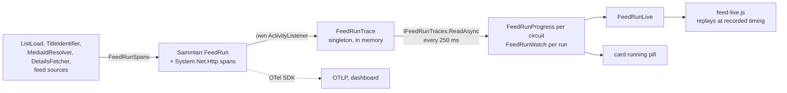

# 6. Cross-cutting Concepts

This chapter holds the rules every layer follows, from typed absence to telemetry. The idea to take away: Core never
waits on a service itself. Every remote call passes a lane that paces it by the limits the provider publishes, and Core
decides whom to ask from what the lanes report. The flows these rules serve are in [Runtime View](04-runtime.md).

## Domain model and kernel

`Domain` holds the media model ([ADR 0009](../../adr/0009-model-a-title-as-an-identity-plus-optional-details.md)). A
resolved title is a `MediaMatchResult` union: `MatchedMedia` (a `MediaIdentity` plus details) or `UnmatchedMedia` (its
external ids, details and an `UnmatchedReason`). Details are one `MediaDetails` record (`MovieDetails`, `ShowDetails`,
`UnknownDetails`) with all fields optional. A search provider or enricher answers with `FoundMedia`, which has no
`MediaId`. `Shared` is the kernel: `Optional<T>`, `Result<T>`, `ValueSet<T>` and the `union` types. Unions are matched
by case, never through `.Value`; enum switches are exhaustive with no default arm (CS8509 is an error).

## Absence and failure: `Optional`, `Result` or `null`

A value that can be missing is an `Optional<T>` wherever our own code hands it on, and an expected failure a
`Result<T>`. `T?` stays where the table puts it, and in media details from the provider mapper to the column
(missing genres are an empty set, missing ratings `MediaRatings.None`).

| `Optional<T>`                                                                                                                                                                                                                             | `T?`                                                                                                                                                                                                                                                                                                                                                                |
| ----------------------------------------------------------------------------------------------------------------------------------------------------------------------------------------------------------------------------------------- | ------------------------------------------------------------------------------------------------------------------------------------------------------------------------------------------------------------------------------------------------------------------------------------------------------------------------------------------------------------------- |
| non-private returns, parameters and properties of our types: `Find…`, lookups, query criteria, record fields that can be missing (`RunQuery.MustInclude`, `FeedOverview.LastRun`, `NotificationTemplate.Level`), `IMediaSink.AddressedBy` | framework edges: EF rows and LINQ query parameters, JSON-persisted columns (`QueryFilter`'s `FilterPredicate`), provider JSON DTOs, Blazor route, query and cascading parameters, `@bind` pairs, Fluid, webhook and Wolverine payloads, Serilog and OpenTelemetry models, BCL overrides and exception constructors |
| a UI parameter or view model whose value comes from the domain                                                                                                                                                                            | UI-only state (selection, loading, busy, binding, create or edit mode, links), private fields, locals, sort keys                                                                                                                                                                                                                                                    |
|                                                                                                                                                                                                                                           |                                                                                                                                                                                                                                                                                                                                                                     |

- `None` means absent, never "not loaded yet"; a failure with a reason is a `Result`.
- An `Optional<T>` member is initialised with `new None()`. `default`, a `null` passed for an `Optional` and an
  unconfigured mock's return hold neither case: `Match`, `Map` and `GetValueOr` throw, and `IsSome`, `IsNone`, `Apply`
  and `ApplyNone` quietly see neither case.
- Across System.Text.Json it needs `OptionalJsonConverterFactory` (Wolverine's serializer registers it; any other must
  add it); an untyped hand-over (`RenderTreeBuilder.AddAttribute`) needs `Optional.Of(x)`. It is never a sort key or
  inside an operator EF translates. `GetValueOr(value)` is eager: pass a `Func` for a costly fallback.
- Side effects go in `Apply`, `ApplyNone` and `ApplyError`, one step each (a step that needs more than one statement
  is a named method); a `ValueTask` step is `async x => await StepAsync(x)`, or it binds the `Action` overload unawaited.
- A `bool` read (`IsSome`, `Match(p, () => false)`) answers a question; outside a loop guard it never routes control
  flow, and a service returns its `Optional`, not a `bool` (`IJobQueue.CancelAsync`).

The custom analyzers and the `AbsenceTests` architecture test enforce these rules at build time.

## Modules and dependency injection

Every layer and provider ships an `IServiceModule` (`Shared/DI`), composed in `Web/Program.cs` with `AddModule<T>()`
([Building Block View](03-building-blocks.md)). A service with several implementations is keyed by an enum
(`IFeedProvider` by `FeedProvider`), resolved through `IKeyedServiceIndex<TKey, TService>` or, to list the keys and
find one, `IKeyedServiceSet<TKey, TService>`.

## Contract shape

- **Snapshots for small lists.** The wantlist, blocklist, outbox and feeds are small per user, so one read returns the
  whole list as a Domain snapshot (`WantlistSnapshot`, `BlocklistSnapshot`, `FeedSnapshot`, `OutboxSnapshot`).
- **Repositories access, services compose.** A repository returns items and counts from its own tables; the service
  builds the snapshot. UI injects no repository but the notification settings ones, nor `IWantlistOutbox`.
  `RepositoryTests` pins who may use each repository and keeps each aggregate's persistence off the others' tables.
- **A query record for unbounded history.** Feed runs are paged through `GetRunsAsync(RunQuery)`.
- **Verbs.** A member's verb says what it does and its type what it acts on: `Get` reads what exists, `Find` what may
  be missing (an `Optional`), `Count…By` returns a dictionary.

## Providers: registration and extension

Providers are registered by hand ([ADR 0010](../../adr/0010-split-the-ids-from-the-services-sammlarr-calls.md),
[ADR 0011](../../adr/0011-give-a-service-every-role-its-api-supports.md)): a provider module registers its clients,
key check, roles, id converters and enrichers through `ForRemote<TOptions>(RemoteService)` (`API/Http`), Radarr +
Sonarr their sink and search through `ForService`. Each role registration records who registered it and which service
the role claims (`Registered`).

- **A service:** a `RemoteService` member with its `Access` and `OwnIds` arms, its brand
  (`UI/Shared/Services/Branding/MediaProviderBrandingService.cs` plus the art), an options record with its section
  (and lanes) in `Web/appsettings.json`, and a module under `API/<Service>`. A key adds an `ApiKeyProvider` slot and a
  key check registered with `ApiKey<T>(slot)`; a sign-in adds an `AuthProvider` member and one class, registered with
  `Credential<T>`, that signs people in and checks their stored token; a keyless service is `Open`.
- **An id source:** a `MediaProvider` member with its id type, its arms in `MediaProvider.Role` and the stored-id
  conversion (`DB/Data/Media/MediaIdConversionExtensions.cs`), its brand and an `IExternalPageLinker`.
- **A rating source:** a `RatingSource` member with `[SuppliedBy<RemoteService>]` (a generator derives `SuppliedBy()`
  and `SuppliedRatingSources()`), a rating type behind `IOwnedRating<TSelf>`, its `Card` arm, each supplier's wire
  mapping and its `RatingTexts`.
- **A downloaded file:** an `IDataset<TRow>`, an `IDatasetTable<TRow>` and a `DatasetLoader<TRow>` ([Datasets](#datasets)).
- **A feed source:** a `FeedProvider` member with its `Service`, a `Feed<T>` registration and a UI `FeedSources` entry;
  browse pages go through a `SiteLink` page table (`AniListPages`, `MalPages`, `TmdbPages`, `TraktPages`). A feed
  source throws on a shape it cannot read and never skips an item.

A member that misses one of these fails the build (the exhaustive switches) or a test: `RoleRegistrationTests` (each
registration matches its claimed service; every role member, remote service and rating source is covered),
`MediaProviderBrandingServiceTests` (brand art), or `StoredEnumNamesTests` (every stored enum name).

## Lanes and HTTP resilience

Every call to a remote service passes a _lane_ (`API/Http/Lanes`): one per service and route, and one per key for
MDBList and per app for Radarr and Sonarr. A lane paces its service by the limits the provider publishes, so Core
never sleeps or throttles ([ADR 0017](../../adr/0017-pace-remote-calls-on-lanes-with-limits-as-published.md)). A remote
client's pipeline, outermost first:

1. A retry of a 5xx, 408, 429 or broken connection, only when the lane would admit it now.
1. The lane permit, one per attempt, so a retry queues like any other request.
1. The attempt timeout (`Http.AttemptTimeoutSeconds`), which is not retried.

Around it, the client's own timeout (`Sammlarr:HttpTimeout`, 30 minutes) bounds the whole call, its wait in the lane
included. Clients that call no remote service (Pushover, the webhook, the picture grids, GitHub) get .NET's standard
resilience handler instead.

### Limits per service

A limit is written as the provider publishes it, requests per window. The `Http` section of each provider in
`Web/appsettings.json`:

| Service | Lanes (`Http.Lanes`) | Waits |
|---|---|---|
| TMDB | `api` 40 per second | `MaxWaitSeconds` 15, `EnrichWaitSeconds` 15 |
| Plex | `api` (plex.tv and the rest) and `metadata`: 50 per second, 25 in flight each; `match`: 5 per second, 5 in flight (Plex answers 429 to a burst of about 15 within a second, and only 8 seconds later); `watchlist`: 4 in flight (Plex publishes no limit) | `MaxWaitSeconds` 90 |
| MDBList | `api` 1,000 per 5 minutes on aligned windows (:00, :05, …); `titles` batches of 200 | |
| Trakt | `api` 1,000 per 5 minutes | |
| AniList | `api` 30 per minute, 1 in flight; `titles` and `prequels` batches of 50 | |
| MyAnimeList | `api` 30 per second, 1 in flight | |
| TVmaze | `api` 20 per 10 seconds | |
| Wikidata | `api` 5 in flight; `sparql` batches of 100 | |
| Radarr, Sonarr | `api` 4 in flight | |
| IMDb datasets, anime lists | `api` 2 in flight | |

A wait left blank is 0: the lane refuses while the service is blocked.

### Admission and refusal

- Waiting attempts go in class order: interactive asks (a search, a click), then list pages, then a list's titles in
  list order, then background work.
- A 429 with `Retry-After` blocks the lane until then. One without halves the rate, which recovers a tenth per quiet
  window.
- Four failed attempts in a row (5xx, 408, timeout, broken connection) take the lane down for 30 seconds; then one
  probe decides.
- Waiting for room in a window is never refused. A down lane, or a block longer than the service's `MaxWait` (counted
  from when the block starts), refuses at once, before anything is sent. MDBList's quota also holds title lookups back
  near the day's reserve.
- Services that take many ids per request (MDBList, AniList, Wikidata) batch them on a keyed lane; a failed batch fails
  every id it carried.

Every lookup ends as an answer: found, no match (a 404), unavailable (refused, or failed past the retries) or faulted.
Only "no match" from every route settles a title as not found.

## Provider routing

Core asks a connected service only when its block ends within the right budget; the lane does any waiting.
`IRemoteCapacity.Of(remote)` folds a service's lanes into a `RemoteLoad` (`BlockedUntil`, `EstimatedWait`, `Down`,
`Paced`, the budgets), read for the asking class (so the details fill sees MDBList blocked at its floor while a feed run
sees it open); an owner's lanes count only for the user who sent through them. `IServiceReadiness` decides what is
connected from `RemoteService.Access` (always for a keyless service; a stored key or sign-in not rejected since it was
stored; a Radarr or Sonarr address and key), never by calling the service. A key check answers `Valid`, `Rejected`,
`Unreachable` or `Spent`; only `Rejected` is remembered.

### Wait budgets

`RemoteLoad.Takes` holds while the service is not down and its block ends within the budget; `AnswersWithin` also
needs the estimated wait inside it. Values are in the [lane table](#limits-per-service).

| Budget | Setting | Gates |
|---|---|---|
| `MaxWait` | the provider section's `Http:MaxWaitSeconds` | each hop of an id lookup path; the lane's patience before refusing (0 by default: only while open) |
| `EnrichWait` | the provider section's `Http:EnrichWaitSeconds` | every enricher ask (0: only while open) |
| `ShownWait` | `Sammlarr:FeedLoad:ShownWait` | an ask for a field the load shows but does not filter or sort on (every field for a stale or uncached title and for the details fill): the service must also answer within it |

## Identity keys and page links

A title's identity is its `MediaId` plus its identity keys
([ADR 0018](../../adr/0018-claim-identity-before-hand-out-from-identity-keys-only.md)).

- An _identity key_ (TMDB, IMDb, TheTVDB, Plex, MDBList, Trakt, MyAnimeList, TVmaze, AniList) names one title. A title
  holds at most one key per source, and matching and claims use keys only.
- A _page link_ (Rotten Tomatoes, Metacritic, Letterboxd) only hangs off a title's details: remakes share a Metacritic
  slug, so a link never joins titles.
- A claim never joins two stored titles ([Ids and the claim](04-runtime.md#ids-and-the-claim)). Two stored titles
  become one only through a merge, from housekeeping's review, which refuses a pair whose ids contradict.

## Persistence and housekeeping

State is one SQLite file through EF Core ([ADR 0004](../../adr/0004-store-all-state-in-one-sqlite-file.md),
[ADR 0003](../../adr/0003-use-ef-core-migrations-for-the-schema.md)).

- Repositories create a context per operation from `IDbContextFactory<SammlarrDbContext>` (the context is `internal`).
- `SqlitePragmaInterceptor` sets WAL and a 5-second busy timeout. Wolverine expires its own dead letters, and
  housekeeping leaves its tables alone.
- `IDatabaseFile.CompactAsync` truncates the log and vacuums when a tenth of the pages are free, after a dataset load
  and after the housekeeping pass.
- `DbInitializer` applies the migrations in `DB/Migrations` at start-up; `UseSeeding` inserts the provider-config row.
  Enums are stored as names, `DateTimeOffset` as binary; `SaveChanges` stamps audit timestamps and the owner.

The `Housekeeping` ticker runs `HousekeepingPass` nightly at 03:00 (`HousekeepingSchedule`), or on demand from
Settings › Housekeeping. It takes the job runner's turn (`JobTurn`), runs each step in order, saves its report after each
step and compacts the file; a failing step stops the pass. The windows are
`Sammlarr:Housekeeping` settings, except the fixed 30 days:

| Step | Removes |
|---|---|
| `RunHistory` | a run's titles, calls and answer times after `RunHistoryDays` (the run keeps its counts) |
| `UsageStats` | usage rows and deleted feeds' names after `UsageDays` |
| `CachedDetails` | details not refreshed for `FreshDays + DetailsUnusedDays` |
| `TitleIds` | a title and its ids once it has had no details for `IdsUnusedDays - DetailsUnusedDays` (from `Media.DetailsTrimmedAt`), or `IdsUnusedDays` after it was added if it never had any |
| `DuplicateTitles` | settles due stored-twice notes |
| `SettledJobs`, `ScheduleEntries` | finished jobs, TickerQ occurrences and one-off runs after 30 days |

- A title on a wantlist, a blocklist, the outbox or in a kept run (`ProtectedMediaIds`) keeps its details and ids. The
  details and ids trims hold `MediaWriteLock`.
- `DuplicateTitles` keeps a pair whose rows contradict apart and asks about every other pair through
  `IIdentityConfirmation`: each user in turn, at the `Background` class, asks the lowest-weight connected converter
  outside the claim's services (`IdentityConflict.Sources`) for the claimed id's source; one that refuses without
  sending passes the note on, to the next converter, then the next user. The claimed id merges the pair, another keeps
  it apart, and no answer asks again after 1, 7, then 30 days.

## Secrets and configuration

- `[Encrypted]` (`DB`) encrypts stored secrets (credentials, API keys, the Radarr and Sonarr keys, notification-target
  secrets) through an EF converter over ASP.NET Core Data Protection. `[Sensitive]` (`Contracts`) only masks a member
  as `***` in logs; a Domain type names its secrets in `SensitiveModel` (`Observability`) instead.
- Static settings (URLs, timeouts, lanes) are options records in `Shared/Options`, each an `IOptionsSection` naming
  its section; a generator (`Roslyn/Options`) binds them all, so a component injects the record itself.
- Settings an admin changes at run time (the sink, the Radarr and Sonarr connections with their keys, the trending,
  search and sign-in providers, the registration mode) are `ProviderConfig`: one global row, cached by
  `ProviderConfigService`.

> [!NOTE]
> Data-protection keys live in a key ring under the application name `Sammlarr` (`EncryptionModule`), so stored
> secrets survive a restart. The ring is `dp-keys` beside the database file unless the environment variable
> `Sammlarr__DataProtection__KeyRingPath` names another folder; configuration files cannot set it. In the container
> the ring shares the `/data` volume ([Deployment View](05-deployment.md)).

## Authentication and per-user isolation

- Accounts are ASP.NET Core Identity's: the user table, roles (`Admin`, `Member`) and Plex logins are Identity's
  tables, `UserManager` and `SignInManager` do the work in `DB`, behind the `ILocalAccountRepository`, `IUserRepository` and
  `ISignInCookie` ports, and each call runs in its own scope so a circuit never holds a context. An install
  signs in one way, `ProviderConfig.AuthProvider`: `Plex`, or `Local` accounts whose password is posted as a form to
  `/auth/local` (a Blazor circuit cannot set a cookie). Identity's lockout applies with its defaults: five wrong
  passwords lock the account for five minutes, and a locked account is told so. Limits per address belong to the
  reverse proxy (or fail2ban), which sees the real one; Sammlarr reads no forwarded headers. The Plex round trip binds
  its state to the browser with a short-lived cookie.
- An invite is a user without a password yet: Settings › Users shows them as invited, and every other list or count
  of users leaves them out until they join. Invite and reset links carry Identity's password-reset token, protected
  with the data-protection key ring: valid for one day, and void once the security stamp changes (a new password, a
  renewed invite, a role change). Nothing about them is stored, so nothing needs purging.
- The cookie is Identity's application cookie. `SecurityStampValidator` checks it on every request
  (`ValidationInterval` zero), so a password change, a role change (which renews the stamp) or a removal signs the
  user out on their next page load; open circuits are signed out at once (`ISessionInvalidator`).
- Isolation lives in persistence ([ADR 0005](../../adr/0005-enforce-per-user-data-isolation.md)): an `IUserOwned`
  entity gets a global query filter on a shadow `UserId`, the current-user lookup throws when nobody is signed in, and
  an ownership stamper sets the owner on insert and blocks changing it. Feeds, wantlist, outbox, blocklist,
  notification targets, API keys and sign-ins are per user; `ProviderConfig` (Radarr and Sonarr included) and the media
  catalogue are global. Background code (the job runner, the feed ticker, Wolverine handlers) runs as the owner through
  `IUserScope.AsAsync(owner)`. Isolation tests: [Quality Requirements](07-quality.md).

## The job queue

The rules every job follows; the walkthrough of a run and a sync is in [Runtime View](04-runtime.md).

- Feed runs, wantlist syncs and the details fill go through one queue of record, the `Jobs` table (`IJobQueue`), and
  one hosted `JobRunner` that runs one row at a time in a fresh DI scope as its owner
  ([ADR 0006](../../adr/0006-run-background-work-through-one-job-queue.md)). The runner holds `JobTurn` meanwhile; the
  housekeeping pass and an admin's merges take the same turn.
- A feed's TickerQ cron ticker only enqueues. Enqueueing coalesces by kind, key and owner, and a deferred row waits in
  `Waiting` until `JobAlarm` releases it (delays under `Sammlarr:Scheduler`).
- A job whose handler throws ends `Failed`, with no automatic retry. The owner can cancel a `Waiting` or `Queued` job
  from Up Next on Home; one the runner already took runs. At start-up a `Running` row goes back to `Queued`, or ends
  `Cancelled` when a like row is already pending.
- The details fill ([FillDetails](04-runtime.md#filldetails)) steps aside: it waits
  `Sammlarr:Scheduler:FillDetailsGrace`, then runs only while no feed run or sync is queued or waiting, or once
  `Sammlarr:Scheduler:FillDetailsMaxWait` has passed.
- A push to the active sink is a step of the sync: pending changes wait in the wantlist outbox and the sync drains it
  ([ADR 0007](../../adr/0007-push-watchlist-changes-inline-during-sync.md)).

## Datasets

A downloaded dataset (IMDb's ratings file, Fribb's anime id map) belongs to the whole app, so it stays out of the
per-user queue ([ADR 0013](../../adr/0013-load-shared-datasets-outside-the-job-queue.md)). `DatasetSchedule` registers
a daily TickerQ ticker per `IDatasetLoader` at 04:30, plus a one-off ticker before the first load. The loader asks
with the last `ETag`, replaces the table in one transaction (a failed or empty file keeps the old one), and records
the load in `DatasetLoads` and the outcome in `DatasetChecks` (Settings › Housekeeping). Until the first load, its
enricher and converter answer `Unavailable`.

## Events and notifications

Anything that reports "something happened" is one of two disjoint kinds, chosen only by whether a user could
reasonably subscribe to it ([ADR 0008](../../adr/0008-separate-events-from-notifications.md)):

| | Event (`IEvent`) | Notification (`INotification`) |
|---|---|---|
| Examples | push status per item, job state, a feed just ran, wantlist and blocklist changes | a sync or feed run finished or failed, a provider is rate limiting |
| Transport | in-process `IEventPublisher` to open pages; never stored | Wolverine, persisted in the app database, to each matching subscription's channel (webhook, Pushover, in-app toast) |
| Retries | none | after 1, 5 and 15 minutes and 1 hour; 5 attempts at most |

Core publishes through `Announcer` (`Announce(IEvent)`, `AnnounceAsync(INotification)`); only the lanes' rate-limit
report (`ProviderRateLimitReporter`) uses `IMessagePublisher` directly.

## Logging and observability

- Serilog with two destructuring policies: one logs a union's payload instead of the wrapper, the other masks
  `[Sensitive]` and `SensitiveModel` members as `***`.
- Sinks: the console; OTLP for logs, traces and the usage meters when `OTEL_EXPORTER_OTLP_ENDPOINT` is set (Aspire
  sets it); an in-memory capture, started in Settings › Diagnostics, that keeps logs and `Sammlarr` spans for the
  admin-only `/diagnostics/export`.
- Tracing is OpenTelemetry over the `Sammlarr` and `Sammlarr.FeedRun` sources plus ASP.NET Core and HttpClient. A
  service opts in through `AddTracedScoped` or `AddTracedKeyedScoped`, a proxy that spans each call. Without OTLP,
  `ActivityLogProcessor` logs spans that errored.

## Usage metrics and Settings › Usage

Every call to a service is counted with the built-in instruments, the retry pipeline per call and HttpClient per
attempt ([ADR 0014](../../adr/0014-count-provider-calls-with-the-built-in-instruments.md)).

- Handlers stamp each call with its `RemoteService`, cause and outcome (`Answered`, `AnsweredAfter429`, `GaveUpOn429`,
  `Failed`, `Cancelled`). A call that never got a lane permit is not counted.
- The cause is an ambient mark (`UsageCauses.Mark`) set at each entry point; the outermost wins, so titles shown inside
  a feed run count for the run. `UsageCause`: `FeedRun`, `WantlistSync` (the sync dialog, adding from a page, a sink
  switch, removing a person), `Dataset`, `Search`, `Browse`, `ShowingTitles` (including the rating breakdown's id
  lookups), `KeyTest`, `FeedEditor` (previews, the link check, saving, the dry run before Run now), `DetailsFill`,
  `Housekeeping`, `Other`.
- Tags stay bounded (service, cause, outcome, feed id); a new feed's previews carry its draft id, and Settings › Usage
  folds ids of feeds never saved into one row.
- `UsageExporter` folds each minute's deltas into hourly rows (`RemoteUsage`, `RemoteAttempts`). A call marked
  `FeedRun` is also credited to the running run (`IFeedRunUsage`) and saved in `FeedRunCalls`.

Settings › Usage (`UsageReport`, admin-only) reads the hourly rows per service, cause and feed; a deleted feed's name
stays in `DeletedFeeds` until its rows are pruned. For MDBList it adds the day's remaining allowance (`MdblistBudget`,
`QuotaDay.Of`).

## Live run trace

While a feed runs, its owner can watch its titles move through the services (the Feeds page's live view and the card's
running pill). The view only observes: a hook that records a step never awaits, never throws and changes nothing the
run decides ([ADR 0016](../../adr/0016-live-runs-pull-from-an-in-memory-trace.md)).

- Spans start through `FeedRunSpans` only under a run span (`IFeedRunTrace.Start`, called by `FeedRunEngine`), so
  Browse, search and the editor preview record nothing. `FeedRunTrace` reads them with its own `ActivityListener`, so
  the view survives sampling. HTTP spans under a hop mark it answered after a 429, or given up.
- The trace keeps one run per feed for 30 seconds after it ends, only for the feed's owner; past 50,000 steps it drops
  path, hop and give-up steps.
- Pages pull rather than subscribe: each circuit's `FeedRunProgress` holds a `FeedRunWatch` per run that reads every
  250 ms, and the browser replays each batch 250 ms behind.
- Each read also brings the run's progress and each service's load, so a blocked lane and one pacing to its window
  (`RemoteLoad.Paced`) show their countdowns.
- The card's last-run bar and every saved number come from the run `FeedRunEngine` records (`FeedRunCounts`), never
  from spans.
