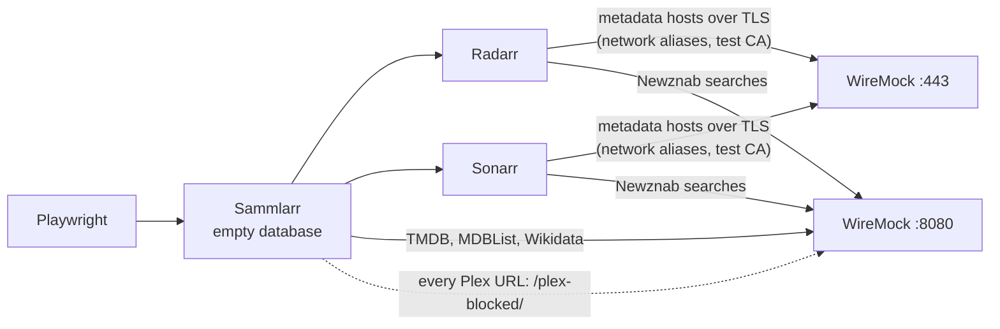

# Testing

A map of how Sammlarr is tested and how to run each tier. The how-to-write detail lives in the
`write-tunit-test` skill; this page is the overview and the one source of truth for commands and environment variables.

Everything runs on **TUnit** over Microsoft.Testing.Platform. Test projects are executables, so the native runner is `dotnet run`, not `dotnet test` (Verify
snapshots need the native runner).

## Tiers

| Tier                      | Project                        | What belongs there                                      | Mechanism                         |
|---------------------------|--------------------------------|---------------------------------------------------------|-----------------------------------|
| Pure unit                 | `Tests/Domain`, `Tests/Shared` | Value objects, unions, algebraic laws                   | plain `[Test]`, CsCheck for laws  |
| Provider clients          | `Tests/API`                    | HTTP clients and converters                             | `TUnit.Mocks.Http` at the handler |
| Single-collaborator units | `Tests/Core`                   | A service with one dependency                           | one `IFoo.Mock()`                 |
| Behaviour + repositories  | `Tests/Integration`            | The real Core+DB+API graph, EF queries, migration drift; the DB converters and conventions (`Tests/Integration/DB`) | `SammlarrTestHost` on real SQLite |
| Components                | `Tests/UI`                     | Blazor render logic, event wiring, empty/error states   | bUnit, `.cs` only                 |
| End to end                | `Tests/E2E`                    | Cross-feature flows through a real browser              | Playwright + Aspire + WireMock    |
| Conventions               | `Tests/Architecture`           | Dependency direction, naming, design rules              | NetArchTest                       |
| Roslyn components         | `Tests/Roslyn`                 | Source generators and analyzers                         | in-memory compilation             |

Rule of thumb: wiring more than one or two `.Mock()`s just to construct the subject means it belongs in `Tests/Integration` as a harness scenario, not a unit
test.

Current suite: **2942** non-E2E tests plus **159** E2E (17 of them on the self-hosted stacks, and the staging smoke test, skipped by default).

| Domain | Shared | Core | API | Architecture | Roslyn | Integration | UI   | Web |
|--------|--------|------|-----|--------------|--------|-------------|------|-----|
| 279    | 183    | 372  | 302 | 44           | 98     | 625         | 1011 | 28  |

## Running

```powershell
dotnet build                                             # always build first
dotnet run --project Tests/Core --no-build               # one tier
dotnet run --project Tests/E2E  --no-build               # E2E (needs Docker)
dotnet run --project Tests/Core --no-build --treenode-filter "/*/*/FilterEvaluatorTests/*"
dotnet run --project Tests/Domain --no-build -- --coverage --coverage-output-format cobertura
```

The non-E2E tiers run in roughly 20 seconds combined; E2E takes about nine minutes, because it boots real application stacks and then runs the self-hosted
batch with its Radarr and Sonarr containers. Never use coverlet: it is VSTest-only and incompatible with MTP.

## The E2E tier

Each test leases an **isolated stack** for its duration: its own Aspire application, WireMock container and SQLite database. Nothing is shared between
concurrent tests, so no test class needs `[NotInParallel]`, and TUnit's parallel limit is the stack count. Stacks boot once per session and are pooled; a
test never runs concurrently with another test on the same stack.

How many stacks the main pool has is `E2EApp.StackCount` (the self-hosted pool's is `SelfHostedApp.StackCount`). More is not automatically faster: each
stack costs an application and a container to boot, and boot dominates a suite this size.

Provider traffic is served by WireMock from committed fixtures under `Tests/E2E/wiremock`: `mappings/<provider>/` holds the request matchers and
`responses/<provider>/` the bodies, which are bind-mounted as WireMock's `__files` (the hand-written `arr-stubs`, `newznab` and `plex-stubs` mappings
carry their bodies inline; `plex-stubs` acknowledges Plex watchlist adds and removals, which a switch back to Plex sends for every title on the stack). Fixtures are committed and `*.verified.json` is pinned to LF by `.gitattributes`.

**Replay** is the default: offline, deterministic, no secrets. **Live** (`E2E_LIVE=true`) makes the main pool proxy the real providers, capture what it
sees, and compare it against what is committed. Each endpoint has a policy in `wiremock/fixture-policy.json`:

- `value`: the live body must match the committed fixture exactly
- `contract`: only the JSON shape is compared, so values may churn freely
- `frozen`: never written; these hold redacted placeholders and must stay that way

A drift failure writes a `.received.json` beside the fixture for review. Non-2xx provider responses are never recorded, so a rate-limited live run cannot poison
the fixture set.

Live runs genuinely mutate: they hit the real accounts. After any live run, scan the fixtures for real tokens and API keys before committing.

A feed run's live view has one flow: `FeedLiveRunTests` creates a feed on the recorded MDBList list, runs it from its card and waits for the view and the card's running pill, then for the fold, five seconds after the run ends, and the card's last-run bar. The view stays until the fold however fast the replayed run is, so the test needs no slowed stub, and since pooled stacks keep their database it asserts the view and the card, not which services the run asked.

### Self-hosted stacks

Tests marked `[SelfHosted]` (`Tests/E2E/SelfHosted`) run on a second pool: two stacks that each run the pinned Radarr and Sonarr images from
`AppHost/ArrContainers.cs` beside Sammlarr, which starts on an empty database with no users, so each test makes its Sammlarr accounts through setup. They
cover what needs an empty install or the real apps: the first run, sign-in, search, the wantlist sync, and what Sammlarr shows when an app refuses its key.



- **Interception.** Radarr and Sonarr hard-code their metadata hosts. WireMock answers to every name in `MetadataHosts` as a Docker network alias, on 443
  with a certificate from a CA made per session (`TestCertificates`). Both apps get that CA through `SSL_CERT_FILE`, which makes it their only trusted root,
  so a call to any other HTTPS host fails.
- **What answers.** Recorded metadata in `mappings/{radarr,sonarr}-metadata` (matched by host); in `mappings/arr-stubs`, stubs for the apps' background calls
  (update check, time, notifications, Sonarr's scene mappings and daily series) and a 404 for every image and scene-numbering request; and a Newznab indexer
  in `mappings/newznab`. The tests read the indexer's requests from WireMock's journal (`SelfHostedStack.IndexerSearchesAsync`).
- **Pool.** `SelfHostedApp` boots both stacks on first use and leases one per test. A used stack is reset when it is leased again: Sammlarr stops and its
  database files are deleted, Sonarr gets its API key back if a test broke it, both apps' command queues settle, both apps lose every title, tag and
  indexer, the indexer is added again, Sammlarr starts on the fresh database, the queues settle once more, and WireMock's journal is kept for the
  session-end check and cleared. `[SelfHosted]` gives these tests their own parallel limit of two and a `ParallelGroup`, so they run as a batch after the
  rest of the suite.
- **The run fails** on any request WireMock could not answer (a Plex call included) and on a crashed circuit, like the main pool.

**Recording.** With `E2E_LIVE=true` the self-hosted pool still replays, with Sammlarr's providers under a `/<provider>` prefix. At session end
`MetadataRecorder` fetches every served or unmatched GET to `api.radarr.video`, `skyhook.sonarr.tv` or one of Sammlarr's providers straight from the real
host (adding the TMDB or MDBList key from user-secrets or the environment itself), writes the mapping and fixture, and compares existing fixtures under the
policies. A request that had no fixture got a 404 in that run, so its test fails: run again until the replay is green.

**After an image bump.** When a tag in `AppHost/ArrContainers.cs` is raised (by hand for now; Renovate takes over once `release-engineering` adds its regex
manager), run `Tests/E2E`. A failing self-hosted test, or an unmatched request in the session failure, names what changed: a new metadata call (record it
with `E2E_LIVE=true` if it goes to `api.radarr.video` or `skyhook.sonarr.tv`, otherwise stub it in `arr-stubs`), a changed API shape (the failing
assertion), or a new host (add it to `MetadataHosts`, and to `ProviderRecording.ArrMetadata` if its calls should be recorded).

What a breaking bump has looked like so far:

| Change                                           | What the run shows                                                                                                    |
|--------------------------------------------------|-----------------------------------------------------------------------------------------------------------------------|
| A metadata call with no fixture                  | the app's lookup gets WireMock's 404, the test that needed it fails, and the session failure names the URL (`https://api.radarr.video/v1/movie/687163`) |
| A new background call                            | nothing fails until the session end, which names it (Sonarr's `services.sonarr.tv/v1/time` and `/v1/notification`)    |
| An app that cannot reach its mocked hosts at all | its lookups answer 503 and the search never shows a result; the app's own log (`GET /api/v3/log`) names the cause, here Sonarr rejecting the test CA's chain |

A bump that only rebuilds the image (Radarr `6.4.4.10685-ls318` to `-ls319`, tried 2026-10-05) passes the self-hosted tests unchanged.

## Staging

Staging is a long-lived, seeded Sammlarr for clicking around by hand, next to the dev session: the `staging` launch profile on the same
`AppHost`, running Sammlarr from the image `Web/Dockerfile` builds, with real Radarr and Sonarr already connected.

```powershell
dotnet user-secrets set Parameters:tmdb-api-key <your key> --project AppHost      # once; Parameters:mdblist-api-key, Parameters:mal-client-id and Parameters:trakt-client-id are optional
dotnet run --project AppHost -c Staging --launch-profile staging
```

The `Staging` configuration builds into `bin\Staging`, so a running staging session never locks the dev build, and dev and staging can run
at the same time. The first start pulls the images and builds Sammlarr's (about half a minute once the layers are cached). The profile opens
the dashboard once the resources are up and Sammlarr once it answers its health check (`LaunchDashboard` and `LaunchSammlarr` in the
profile; the staging smoke test does neither).

| Resource | Where | Notes |
|----------|-------|-------|
| Sammlarr | http://staging.localhost:6789 | its own host name, so its sign-in cookie never replaces the dev one on `localhost` |
| Dashboard | http://localhost:15224 | logs, traces and the commands below; anonymous, like everything here only on 127.0.0.1 |
| Radarr / Sonarr | http://localhost:7879, http://localhost:8990 | persistent containers, key `0123456789abcdef0123456789abcdef` |
| Catcher | http://localhost:6790 | every webhook and Pushover message staging sends (`tarampampam/webhook-tester`) |
| WireMock | http://localhost:6791/__admin/requests | persistent like Radarr and Sonarr, so their indexer never goes away; the Newznab indexer, and every Plex call (reads proxied, watchlist writes caught) |

Every port is published on 127.0.0.1 only.

**Settings** live in `AppHost/appsettings.Staging.json`, which the staging profile loads on top of the AppHost's own: under
`Staging`, the host name, the ports, the catcher session, the proxy and its allowlist, the two personas and `Seed`, what the seed puts in
(the wantlist's titles by TMDB, TVDB or IMDb id, the feeds, the Radarr library by TMDB id and the Sonarr one by TVDB id with each title's
`OnDisk` and tag `Owner`, the webhook's and Pushover's names and secrets, and the title and message template both subscribe to every event
with); under `Sammlarr`, settings handed as they are to the staged Sammlarr and its seed (the setup code
and `Accounts:MinimumPasswordLength`; the seeded webhook belongs to the admin, and an admin's webhook reaches the catcher over http on its private address).
The values above are its defaults.

**Scenarios.** The `seed` resource (Web started with `seed-staging`, its code in `Web/Staging`, which the published image leaves out) prepares Radarr and Sonarr (root folder, a blackhole
download client, the Newznab indexer, a small library: titles on disk, monitored titles without files, and The Martian tagged for `admin`
so the pull-back path shows; each step skips what is already there) and, unless the database carries the `.seeded` marker of a finished seed, seeds a scenario:

| Scenario | State |
|----------|-------|
| `Configured` (default) | the personas `admin` / `admin` and `member` / `member` (staging lowers `Sammlarr:Accounts:MinimumPasswordLength` to 5), setup finished, the wantlist on Radarr + Sonarr (their External URLs on the published ports, so links open in your browser), both people's TMDB key (and the MDBList key, MyAnimeList client ID and Trakt client ID when `Parameters:mdblist-api-key`, `Parameters:mal-client-id` and `Parameters:trakt-client-id` are set), a manual feed on every feed provider (two MDBList lists, TMDB list 1, this season on AniList and on MyAnimeList, Trakt's trending movies), each on while its service is ready for the admin, so the MDBList, MyAnimeList and Trakt ones need their keys, Project Hail Mary and Breaking Bad on the admin's wantlist with a sync queued, a webhook and a Pushover target pointing at the catcher |
| `Fresh` | migrations only: every page goes to `/setup`, which takes the setup code `SAMM-LARR` (the AppHost sets `Sammlarr:Accounts:SetupCode`; unset, Sammlarr makes one and logs it) |

Appending `-- --StagingScenario=Fresh` to the run command picks the other one for a new data directory. The seeded feeds are manual because TickerQ only schedules inside a
running Sammlarr; switching one to a schedule in staging schedules it as usual.

**Commands** on the `sammlarr` resource, from the dashboard (or `aspire resource sammlarr <command>` while staging is the only AppHost running), each confirming first, one at a time:
`restage` (the `Configured` scenario) and `reset` (the `Fresh` one) stop Sammlarr, Radarr and Sonarr, wipe their data, run the
seeder again and start everything; `rebuild` rebuilds the image from the working tree and restarts Sammlarr.

**What is real and what is caught.** TMDB, MDBList, Wikidata, TVmaze, IMDb's ratings file, AniList, MyAnimeList, Trakt and the anime id map (`raw.githubusercontent.com`) are real (with your keys). Radarr and Sonarr use their own metadata
services. Plex is read-only: its APIs (`Plex` in the settings) go through WireMock, which proxies sign-in, search, the watchlist and
metadata to the real Plex (`AppHost/Staging/wiremock/plex.json`) but answers watchlist adds and removes itself, so they show in its journal and
never reach your watchlist; Plex's images and sign-in page stay the real ones. Webhooks and Pushover (`Pushover:BaseUrl`) go to the catcher, and Sammlarr's
`HTTP_PROXY`/`HTTPS_PROXY` point at a dead port with a `NO_PROXY` allowlist, so a call to any other host fails. Searches go to WireMock's
Newznab indexer, which answers every title search with one release; the AppHost's fake downloader turns each grabbed `.nzb` into
`downloads/<app>/watch/<release>/<release>.mkv` from `AppHost/Staging/stub.mkv`, and Radarr imports it about a minute and a half later. Sonarr
searches a new show season by season, and a one-file season pack stays in its queue unimported.

**Data** lives under `%LOCALAPPDATA%\Sammlarr\staging` (`-- --StagingRoot=<dir>` moves it) and survives restarts; it is never `Web/sammlarr.db` or
`Web/dp-keys`. Radarr, Sonarr and WireMock keep running after the session stops, as `sammlarr-staging-radarr`, `-sonarr` and
`-wiremock`. `aspire stop --force` does not remove them for a session started with `dotnet run`;
`docker rm -f sammlarr-staging-radarr sammlarr-staging-sonarr sammlarr-staging-wiremock` does, and their data stays in the data directory.

`Tests/E2E/Staging/StagingSmokeTests` boots the staging profile on a temporary data directory, with session containers on free ports, and
signs in as `admin`. It is skipped unless `E2E_STAGING=true`: it builds the image and needs the internet (Radarr's and Sonarr's metadata
services), and in two of three full runs on 2026-10-05 DCP's image build ran past the ten-minute boot budget. With the variable set it runs
alone (`[NotInParallel]`).

## Environment variables

| Variable                 | Effect                                                                         |
|--------------------------|--------------------------------------------------------------------------------|
| `E2E_LIVE=true`          | Live record mode against the real providers; needs secrets and forces one main-pool stack. The self-hosted pool keeps its two stacks, keeps replaying and records what it can fetch |
| `E2E_HEADED=true`        | Headed browser with slow motion, for watching a test run                       |
| `E2E_STAGING=true`       | Run `StagingSmokeTests`, which boots the staging profile (builds the image, needs the internet) |
| `E2E_PRUNE=true`         | Delete fixtures the live run did not capture. Opt-in on purpose: a filtered run only touches some endpoints, so pruning would delete the rest |
| `E2E_AUDIT=true`         | Dump the main pool's served and unmatched request URLs to the temp directory   |
| `E2E_RESOURCE_LOG=<dir>` | Write each stack's application log to `<dir>/stack-<n>.log` (`self-hosted-<n>.log` for the self-hosted pool) |

Live secrets come from `dotnet user-secrets` on `Tests/E2E`, named from the generated provider enums: `{PROVIDER}_API_KEY` and `{PROVIDER}_TOKEN`, for example
`TMDB_API_KEY`, `PLEX_TOKEN`. `TMDB_API_KEY` is required: the seeded member gets the same TMDB key, since a member without one is sent to the key prompt.

## Mutation testing

Stryker is an occasional local audit, never a CI gate. It answers a question coverage cannot:
would a test actually fail if this line were wrong. Configs live next to the project under test and must be run from that directory, otherwise Stryker enters
solution context and runs every test project, including E2E.

```powershell
cd Domain; dotnet dotnet-stryker            # report at StrykerOutput/<timestamp>/reports/
'Domain', 'Core' | ForEach-Object { Push-Location $_; dotnet dotnet-stryker; Pop-Location }
```

It cannot run against `UI` or `Web`: Stryker bundles an older Roslyn than this SDK's Razor generator, so no `.razor` component produces a type and the projects
fail to compile inside it.

Read the `replacement` field in the report rather than the mutator name, and expect equivalent mutants. Scheduling code, deliberately redundant guards and
literal arguments like
`destructureObjects: true` often produce survivors that are not test gaps.
