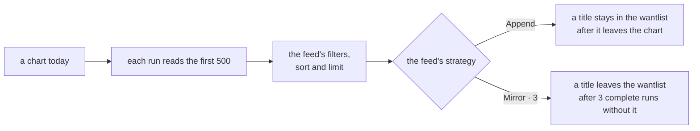
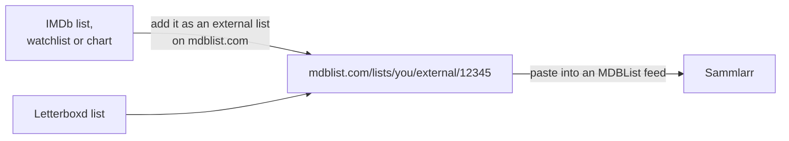

# FAQ

## Which links can I paste into a feed?

Paste a link into a feed and the editor either takes it or says why not. A private list shows up when the preview loads.

| Your list is on                                                           | Paste it into                                                                      | Needs                                                                      | Limits                                                          |
|---------------------------------------------------------------------------|------------------------------------------------------------------------------------|----------------------------------------------------------------------------|-----------------------------------------------------------------|
| MDBList                                                                   | an MDBList feed                                                                    | an MDBList API key                                                         | none beyond MDBList's daily requests                            |
| IMDb (list, watchlist, chart)                                             | an MDBList feed, after adding it on mdblist.com as an external list                | an MDBList API key                                                         | a free MDBList account adds one external list, refreshed weekly |
| Letterboxd (list)                                                         | an MDBList feed, the same way                                                      | an MDBList API key                                                         | the same                                                        |
| TMDB (list, movie or TV page, discover, keyword, company or network page) | a TMDB feed                                                                        | a TMDB API key; the read access token for a list only TMDB's v4 API serves | pages: the first 500 titles                                     |
| Trakt (watchlist, public list, trending, popular or anticipated chart)    | a Trakt feed                                                                       | your own Trakt client ID                                                   | the profile must be public; charts: the first 500 titles        |
| AniList (anime list, search page)                                         | an AniList feed                                                                    | nothing                                                                    | the list must be public; searches: the first 500 titles         |
| MyAnimeList (anime list, top anime, season)                               | a MyAnimeList feed                                                                 | a MyAnimeList client ID                                                    | the list must be public; pages: the first 500 titles            |
| TheTVDB                                                                   | not followed                                                                       |                                                                            |                                                                 |
| Plex watchlist                                                            | not a feed: it is where your wantlist goes, and a sync pulls your own watchlist in |                                                                            |                                                                 |

What each site's feed takes:

<b>MDBList</b>

Works:

- a list's link, `https://mdblist.com/lists/{owner}/{list}`, or just `{owner}/{list}`
- the list's number. Sammlarr looks it up with your key, since mdblist.com has no page by number.
- an external list, `https://mdblist.com/lists/{you}/external/{id}`

Not followed: anything else, an IMDb, Trakt or Letterboxd link pasted directly included. The editor says "Paste the list's link from mdblist.com, its
owner/list, or its number."

<b>TMDB</b>

Works:

- a list: `https://www.themoviedb.org/list/{id}`, or the number alone
- the movie and TV pages: `/movie` (popular), `/movie/now-playing`, `/movie/upcoming`, `/movie/top-rated`, `/tv`
  (popular), `/tv/airing-today`, `/tv/on-the-air`, `/tv/top-rated`, with their region, language or timezone
- a discover link, `/discover/movie` or `/discover/tv` with its filters, and `/movie` or `/tv` with filters, which is the same thing
- `/keyword/{id}/movie` or `/tv`, `/company/{id}/movie` or `/tv`, `/network/{id}/tv`

Not followed:

- a discover preset such as "new on streaming": "Sammlarr cannot follow TMDB's new-on-streaming preset, since the API has no list for it. Paste the discover
  link its filters give."
- `/tv/upcoming`, collections, people and a single movie or show page, which have no list in TMDB's API
- a streaming-service filter without its `watch_region`, and a certification without its `certification_country`, because TMDB counts both per country
- a filter on a page that has none in the API, for example a genre on `/movie/now-playing`: "Sammlarr cannot follow TMDB's with_genres filter. Remove it from
  the page, or filter in Sammlarr."

A list only TMDB's v4 API serves needs the read access token, from the same TMDB settings page as the key.

<b>Trakt</b>

Works:

- a username alone, which follows that person's watchlist
- `https://trakt.tv/users/{user}` or `/users/{user}/watchlist`
- `https://trakt.tv/users/{user}/lists/{list}` and `https://trakt.tv/lists/{id}`
- the charts `/movies/trending`, `/movies/popular`, `/movies/anticipated` and the same under `/shows/`
- `https://app.trakt.tv/discover/{trending, popular or anticipated}`, with `?mode=movie` or `?mode=show`, or both charts without a mode

Links on `app.trakt.tv` work the same as on `trakt.tv`.

Not followed: other charts and pages (box office, most watched, people), and a private profile: "Trakt keeps the profile behind users/{user}/watchlist private,
so Sammlarr cannot read it."

<b>AniList</b>

Works:

- a username, which follows the whole anime list
- `{user}/{status}`, with `current`, `planning`, `completed`, `dropped`, `paused` or `repeating`
- `https://anilist.co/user/{user}/animelist`, with or without one of those statuses at the end
- `https://anilist.co/search/anime` with its filters: search, genres and tags, year, season, format, airing status, source material, country of origin, year
  range and sort
- the presets under it: `trending`, `popular`, `top-100`, `new`, `favorites`, `top-tv`, `top-tv-shorts`,
  `top-movies`, `top-ova`, `top-ona`, `this-season`, `next-season`

AniList's Watching and Rewatching lists are `current` and `repeating` here.

Not followed: the streaming, episodes and duration filters, manga, studio and staff pages, and a private list:
"AniList keeps the list of {user} private, so Sammlarr cannot read it."

<b>MyAnimeList</b>

Works:

- a username, `https://myanimelist.net/animelist/{user}` or `/profile/{user}`. A status in the link is ignored; the feed reads the whole list.
- `https://myanimelist.net/topanime.php` with `type` set to `all`, `airing`, `upcoming`, `tv`, `ova`, `movie`,
  `special`, `bypopularity` or `favorite`, and its `limit` to start further down
- `/anime/season` (this season) and `/anime/season/{year}/{season}`

Not followed: the search, "Sammlarr cannot follow MyAnimeList's search, since it ranks by relevance. Paste a top anime or season link."; the ONA and music
rankings, genre and studio pages, and a private list: "MyAnimeList keeps the list of {user} private, so Sammlarr cannot read it."

## What does a feed do with a chart?

A feed can follow more than a list. It can follow a site's chart, ranking or search page, which changes on its own between runs.

| Kind                      | Examples                                                                                                                                  | Changes                              | What a run reads                                    |
|---------------------------|-------------------------------------------------------------------------------------------------------------------------------------------|--------------------------------------|-----------------------------------------------------|
| A list                    | an MDBList list, a TMDB list, a Trakt list or watchlist, an AniList or MyAnimeList anime list                                             | when its owner edits it              | every title, in the list's order                    |
| A chart                   | Trakt trending, popular, anticipated; TMDB popular, top rated, now playing, upcoming; MyAnimeList top anime; AniList trending and top 100 | every day, by the site's own ranking | the first 500 titles, in the chart's order          |
| A season or calendar page | MyAnimeList this season or a given season; AniList this season, next season or a season search; TMDB airing today, on the air             | as the season moves on               | the first 500 titles                                |
| A search or discover page | AniList's search with its filters; TMDB discover, keyword, company and network pages                                                      | as new titles match                  | the first 500 titles, sorted as the page sorts them |

- **The limit counts after the filters.** "The top 20 of Trakt's trending shows rated 7 or better" reads the chart, drops what fails the filters, then keeps 20.
- **Append or Mirror decides what a chart does to the wantlist.** Append only adds, so a chart builds up a backlog of everything that was ever on it. Mirror
  also removes what this feed added once the title has been missing from 3 complete runs in a row (you set the number per feed). Missing means it left the
  chart, or it no longer passes the feed's filters or limit. So the wantlist follows the chart.
- **Only a complete run counts.** A run is complete when it read the whole source, looked up every title and let at least one through the filters. Any other run
  removes nothing and counts nothing as missing, so a site that is down or a lookup that hit a rate limit never empties your wantlist.
- **The schedule sets how closely a feed follows.** A daily chart on a weekly schedule only sees one day a week.
- Pick by what you want: "what everyone watches right now" is a chart with Mirror, "everything that was ever big" a chart with Append, "this season's anime" a
  season page with Mirror.

## Why does a run read only the first 500 titles?

Charts, searches and discover pages never end, and a run must. Lists are read whole.

## Why do IMDb and Letterboxd lists only work through MDBList?

- **IMDb** has no API for lists. Its pages answer scripts with a bot check, its conditions of use forbid scraping, and its own data API is a paid AWS product.
  MDBList mirrors IMDb lists, watchlists and charts as external lists.
- **Letterboxd** gives API access by application only, and not to private or personal projects. MDBList mirrors its lists and watchlists too.

A free MDBList account adds one external list, refreshed weekly, and stops updating its lists after 120 days without activity on mdblist.com (a note on the list
warns at 90). Supporters get more external lists, refreshed daily, and no inactivity rule.

## Can I follow a Trakt list through MDBList?

Not any more. Trakt blocked MDBList from its API in September 2026, so Trakt lists added on MDBList no longer update. Follow a Trakt list with a Trakt feed
instead.

## Why can't I follow a list on TheTVDB?

TheTVDB licenses its API per project, priced by the project's revenue, and its terms keep a key confidential to the project it was issued for. Sammlarr ships no
key and never calls TheTVDB: TVDB ids come from other services, and TheTVDB's pages are only linked.

## Why can't Sammlarr read my private list?

A private list on Trakt, AniList or MyAnimeList would need each person to sign in to that site. Sammlarr reads only what the site shows to anyone, so make the
list public.

## Why does the editor turn down a page that works on the site?

Sammlarr follows only pages that map onto the site's API, because only those come back with the same titles in the same order. MyAnimeList's search ranks by
relevance, which its API cannot repeat; TMDB's presets, collections and people have no list in its API. The editor says so when you paste one.

## Why do I need my own API keys?

Each service ties a key to its owner and counts calls against it, so Sammlarr ships none and each person adds their own in Settings › Providers. Trakt's API
policy allows a personal or self-hosted tool on your own credentials. Settings › Usage (admin only) shows how many calls each service got and why.

## What do the services allow for free?

| Service     | Free limits                                                                                                                    |
|-------------|--------------------------------------------------------------------------------------------------------------------------------|
| TMDB        | free for non-commercial use; about 40 requests a second                                                                        |
| Plex        | none published                                                                                                                 |
| MDBList     | 1,000 requests a day on a free account; supporters get more                                                                    |
| Trakt       | 1,000 calls every 5 minutes. Trakt asks for a verified GitHub account to create an app, and deletes an app unused for 30 days. |
| AniList     | 90 requests a minute, 30 while AniList runs degraded                                                                           |
| MyAnimeList | none published                                                                                                                 |
| TVmaze      | 20 calls every 10 seconds                                                                                                      |
